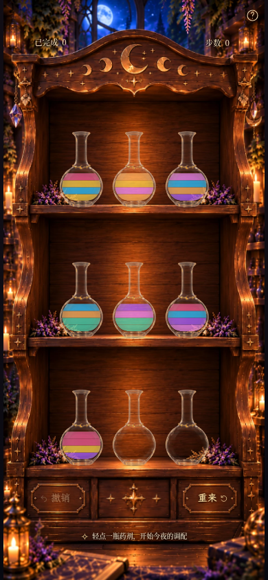
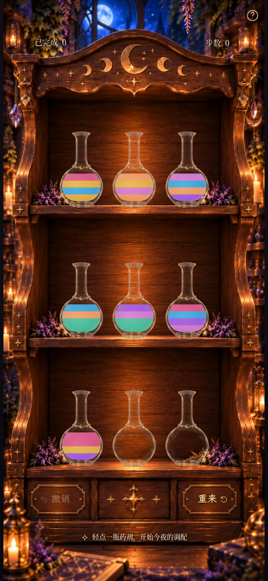
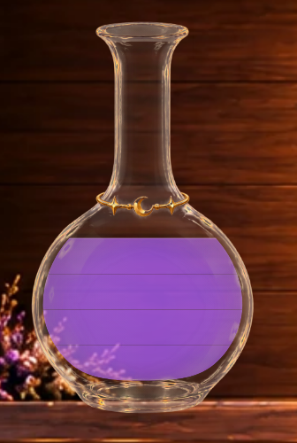
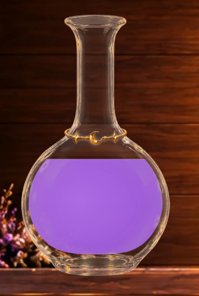
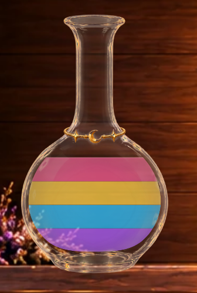

# 药液材质方向重制 · luminous-liquid

默认 / `?liquid=luminous-liquid`：通过液体自身的同色系亮部与深部表现透亮感，提高颜色覆盖度以压住木纹。
异色只留更细的柔和灰线，同色连续单位不画横线。旧 `vivid-translucent` 及全部历史模式保留，参数不写存档。

## 同状态完整页面

真实生产构建、可玩的moon-2初始局面，相同390×844 / DPR1、相同2200ms捕获时刻。
左侧与3I原交付图逐像素一致；新版HUD区域也逐像素一致。

| 旧默认 vivid-translucent | 新默认 luminous-liquid |
| --- | --- |
|  |  |

[新版390×844原图](liquid-luminous-game-luminous-liquid-390x844.png) ·
[360×640新版](liquid-luminous-game-luminous-liquid-360x640.png) · [360×640旧版](liquid-luminous-game-vivid-translucent-360x640.png) ·
[320×568视口](liquid-luminous-game-luminous-liquid-320x568.png) · [1280×900桌面](liquid-luminous-game-luminous-liquid-1280x900.png)。短屏沿用原有纵向滚动。

合法34步完成局面，查看七色满瓶：[旧版](liquid-luminous-completed-vivid-translucent-390x844.png) ·
[新版](liquid-luminous-completed-luminous-liquid-390x844.png)。两图使用减少动态效果以稳定木板机关光效。

## 单瓶真实浏览器特写

下列为只读组件夹具：在实际木柜页面中用现有开发夹具渲染真实 `BottleArt`，仅替换index0显示。
页面临时 `inert`，存档字符串前后相同，重载退出；没有将非法棋盘写入存档或修改谜题。
主游戏图和录像使用生产构建4192，夹具用Vite4191加载同一份组件源码，不进入正式构建。
新方案每组都有正常手机完整页；局部由相同390×844视口、DPR4浏览器裁剪。没有静态美术合成。

[夹具数组](liquid-luminous-fixtures.json)，顺序为瓶底→瓶顶；A=紫水晶、B=蜂蜜金。

| 状态 | 新版手机完整页 | 旧版局部 | 新版局部 |
| --- | --- | --- | --- |
| 空瓶 | [完整页](liquid-luminous-fixture-empty-390x844.png) | [旧](liquid-luminous-fixture-empty-vivid-translucent-detail.png) | [新](liquid-luminous-fixture-empty-luminous-liquid-detail.png) |
| 一层蓝色 | [完整页](liquid-luminous-fixture-blue-1-390x844.png) | [旧](liquid-luminous-fixture-blue-1-vivid-translucent-detail.png) | [新](liquid-luminous-fixture-blue-1-luminous-liquid-detail.png) |
| 一层紫色 | [完整页](liquid-luminous-fixture-purple-1-390x844.png) | [旧](liquid-luminous-fixture-purple-1-vivid-translucent-detail.png) | [新](liquid-luminous-fixture-purple-1-luminous-liquid-detail.png) |
| 一层蜂蜜金 | [完整页](liquid-luminous-fixture-gold-1-390x844.png) | [旧](liquid-luminous-fixture-gold-1-vivid-translucent-detail.png) | [新](liquid-luminous-fixture-gold-1-luminous-liquid-detail.png) |
| 单色四单位满瓶 | [完整页](liquid-luminous-fixture-mono-4-390x844.png) | [旧](liquid-luminous-fixture-mono-4-vivid-translucent-detail.png) | [新](liquid-luminous-fixture-mono-4-luminous-liquid-detail.png) |
| 两层异色 | [完整页](liquid-luminous-fixture-different-2-390x844.png) | [旧](liquid-luminous-fixture-different-2-vivid-translucent-detail.png) | [新](liquid-luminous-fixture-different-2-luminous-liquid-detail.png) |
| 四层异色 | [完整页](liquid-luminous-fixture-different-4-390x844.png) | [旧](liquid-luminous-fixture-different-4-vivid-translucent-detail.png) | [新](liquid-luminous-fixture-different-4-luminous-liquid-detail.png) |
| A / A / B | [完整页](liquid-luminous-fixture-AAB-390x844.png) | [旧](liquid-luminous-fixture-AAB-vivid-translucent-detail.png) | [新](liquid-luminous-fixture-AAB-luminous-liquid-detail.png) |
| A / A / B / B | [完整页](liquid-luminous-fixture-AABB-390x844.png) | [旧](liquid-luminous-fixture-AABB-vivid-translucent-detail.png) | [新](liquid-luminous-fixture-AABB-luminous-liquid-detail.png) |

### 同色满瓶：连续体积，没有内部横线

| 旧默认 | 新默认 |
| --- | --- |
|  |  |

### 四层异色：平整界面、极细提示

| 旧默认 | 新默认 |
| --- | --- |
|  |  |

## 材质实现：液体自己的亮部与深部

- 液体总体覆盖度为 **.98**，仅保留约2%的环境混合，正常木纹不再成为液体内部纹理。
- 颜色主层上叠加各自同色相的亮调、深调。不是白色罩层，也不是灰黑阴影；七色ID、顺序、中文名及游戏含义不变。
- 亮调共用一个固定瓶腔坐标的宽径向权重场，中心(42,98)、半径53，纵横尺度1.1/.95，权重.48→.22→0。
- 深调共用一个固定y72–136的纵向权重场，权重0→.025→.12，变化很轻，不为每个色层重启顶亮底暗。
- 两张权重遮罩中的白色只编码Alpha；实际绘制的是该颜色的亮调/深调，因此光感带颜色，保留鲜明度。
- 坐标不随液量重新归一化。光照场随瓶腔旋转，液体界面反向补偿角度保持世界水平，湿区和瓶腔双重裁剪。
- 最上方只保留一条.45 SVG单位、.42透明度的自由液面提示，没有波浪或厚椭圆亮边。

配色相较3I降低了为透底补偿而设置的高能量输入，转为色彩主体、亮调和深调共同塑形。
无发光滤镜、切面、粒子、闪粉或新的动画循环；原玻璃仍提供主要的表面反光。

## “透缝”的实际修正

相邻小矩形各自抗锯齿时，接缝处的覆盖度会下降，即使不画分隔线，同色满瓶也可能留下横线。
初步版本在黑白诊断底色切换时，界面采样点曾出现约50/255的RGB变化；仅缩小线宽无法修复它。

新版先用底色铺满整个实际湿区，再把每个上层颜色覆盖到其精确下界；亮调和深调也采用同样的连续覆盖。
所有内部边缘都有完整液体颜色承接，抗锯齿只混合相邻液色，不漏出木柜。
覆盖度统一施加一次，不逐单位叠加。此绘制方式改变了矩形覆盖范围，**没有改变任何单位平面或容量模型**。
自动化同时验证逻辑平面与旧版本一致，以及实际覆色矩形的下边缘精确落在对应单位平面。

| 边界 | 旧3I | 新版 |
| --- | --- | --- |
| 异色线宽 | .38 SVG单位 | **.22 SVG单位**（390×844约.19 CSS px） |
| 异色峰值透明度 | .20 | **.12** |
| 色调 | `#544d47` | 更轻的柔和灰 `#62595a` |
| 同色单位 | 每单位一道线 | **取消内部横线，连续呈现** |

异色界面为0→.02→.12→.02→0的渐隐灰线，无透明挖空或黑色描边。
四种不同颜色仍对应严格等高四格；AABB只留中间一道异色提示，同色段的逻辑单位仍完整保留。

## 实际倒药录像

[MP4](liquid-luminous-pour.mp4) · [GIF](liquid-luminous-pour.gif)

实际浏览器按正常时钟执行0→7、6→0、0→8、7→0四次合法触摸倒药。
验证最终为4步、index0三单位蜂蜜金。包含上浮、跨层移动、倾斜、接收上升与回位；没有静态图拼接或修改倒药节奏。
原始记录为277帧、跨度7.974秒；MP4与GIF均为390×844、8.20秒（含末帧停留），分别30fps和20fps。
视频采样不代表实体手机的运行帧率。

[来源完整页](liquid-luminous-pour-0.png) · [接收完整页](liquid-luminous-pour-1.png) ·
[来源局部](liquid-luminous-source-detail.png) · [接收局部](liquid-luminous-receiver-detail.png) ·
[选中](liquid-luminous-selected.png) → [120ms](liquid-luminous-flight-120ms.png) →
[320ms](liquid-luminous-flight-320ms.png) → [540ms](liquid-luminous-flight-540ms.png) →
[790ms](liquid-luminous-flight-790ms.png) → [回位1040ms](liquid-luminous-flight-1040ms.png)。
单张关键帧由固定视口和浏览器时钟定位，视频按真实时钟录制。

## 验证、范围与限制

**88项单元测试、124项Playwright浏览器测试全部通过（约3.2分钟）；生产构建与 `git diff --check` 通过。**
新增模式与存档/几何一致性、来源/接收/回位/减少动态效果、共享光场稳定性及像素级防漏底检查均通过；
原规则、奖励、撤销/重来/新谜题、HUD/按钮与响应式回归继续通过。
诊断用黑白底只在测试页面临时插入，采样四个单位中心和三处内部界面，RGB变化不超过7/255；正常交付截图不使用诊断底色。

新增 `BrightLiquid.tsx`，修改 `Bottle.tsx` 的模式接入和 `liquidAppearance.ts` 的候选配置。
旧 `vivid-translucent`、3H A/B、clean及更早模式全部保留，没有玩家UI开关，也不写存档。
`bottleGeometry.ts`、`PourAnimation.tsx`、玻璃/环境光/素材、九瓶尺寸落点、木柜/HUD/帮助/按钮/结算/字体与 `src/game/` 未改。
**640ms提交 /920ms时序、水平液面与实际瓶口流线保持原机制。**

这仍是二维插画式内部受光，不是真实三维折射；同色段依照本轮要求不再显示单位刻线。
异色细线在不同DPR屏幕上的可见程度会变化，实体Safari/iOS及低端GPU未验证。
完成本轮后停止，等待视觉验收，不扩展特殊药剂、其他瓶型、UI或玩法。
