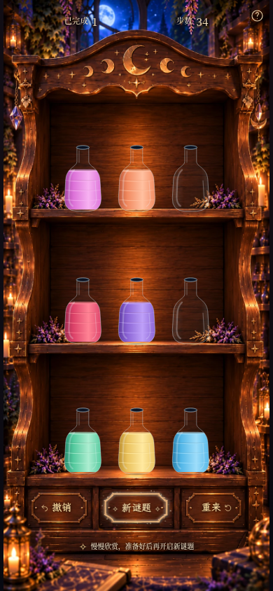

# Milestone 2E Fine Polish · 真实浏览器对比

仅调整粒子大小、HUD 横向间距、帮助图标内部位置和左右按钮内容内边距。
截图均为 Chromium 实际游戏，使用相同已完成谜题（34 步）和字体。
完整画面不放大；局部图来自同一 390×844 CSS 视口、3× 设备像素密度。

| 画面 | 调整前 | 调整后 |
| --- | --- | --- |
| 390×844 完整常驻状态 | [前](milestone2e-fine-before-390x844.png) | [后](milestone2e-fine-after-390x844.png) |
| 360×640 完整常驻状态 | [前](milestone2e-fine-before-360x640.png) | [后](milestone2e-fine-after-360x640.png) |
| 顶部 HUD 与问号 | [前](milestone2e-fine-before-hud.png) | [后](milestone2e-fine-after-hud.png) |
| 底部三个按钮 | [前](milestone2e-fine-before-buttons.png) | [后](milestone2e-fine-after-buttons.png) |
| 中央魔法粒子 | [前](milestone2e-fine-before-particles.png) | [后](milestone2e-fine-after-particles.png) |

前后静态图都将真实 CSS 粒子时间线暂停在同一 2.2 秒时刻，保留每颗不同的负延迟。
两帧均有 27 颗粒子的实际透明度高于 0.15，避免用稀疏瞬间造成误导。没有合成游戏图像。

## 实际位移（390×844）

- HUD 两组中心从 x≈132.37／257.63 调至 x≈115.29／274.70，各向外约 **17.08px**，仍关于 x=195 对称。
- 帮助可见图标向右、向上各 **3.5px**；44×44px 点击区域的位置和大小不变。
- 撤销内容向右 **4.55px**，重来内容向左 **4.55px**，两组宽高及图文间距不变。
- 圆形粒子直径增加 **65%**，四枚小星芒增加 **60%**；仍为 36 个错相粒子，大小与亮度层次保留。
- 边框在无悬停、无焦点时的 opacity 前后均为 **0.94**；混合光色、描边和光晕参数未改。

## 粒子真实动态

[完整手机画面 MP4](milestone2e-fine-particles.mp4) · [底部放大 GIF](milestone2e-fine-particles.gif)

约 5 秒连续 Chromium 实时录屏，独立于暂停的对比截图。GIF 只裁取并放大同一录屏底部，
展示粒子闪烁、缓慢外飘、消失和循环。视频未改变粒子动画速度或替换背景。
