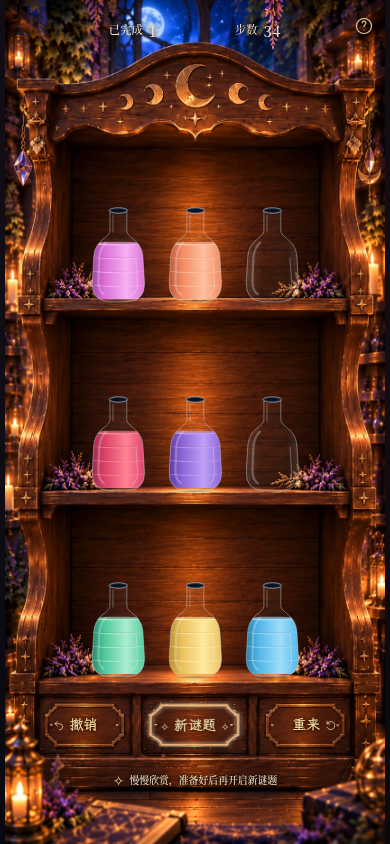

# Milestone 2E Visual Patch · 真实浏览器验收

本页图片和视频均来自最新生产构建的 Chromium 实际游戏。木柜、瓶子位置、
650ms 翻板和 920ms 倒药机制保留；结算后仍是实际完成的 34 步棋盘。

## 常驻混合发光

以下四张均为 **390×844 完整视口**：

- [翻转接近结束（600ms）](milestone2e-patch-near-end-390x844.png)
- [翻转结束后 1 秒](milestone2e-patch-glow-1s-390x844.png)
- [翻转结束后 5 秒](milestone2e-patch-glow-5s-390x844.png)
- [翻转结束后 10 秒](milestone2e-patch-glow-10s-390x844.png)

1/5/10 秒的实测采样时间为 **1.002 / 5.003 / 10.002 秒**；全部确认
`:hover = false`、`:focus-visible = false`，边框层 opacity 始终为 **0.94**。
贴边暖金亮部、暖黄铜光体和外扩浅香槟光晕叠加，星尘继续独立闪烁漂移。
600ms 图片暂停真实 CSS 转动时间线以清晰展示临近结束状态，其余三张使用真实等待。

[完整视口实时录屏 MP4](milestone2e-patch-persistent-glow.mp4) ·
[底部局部 GIF](milestone2e-patch-persistent-glow.gif)

录像连续覆盖关闭结算、翻转及完成后十秒；来自 Chromium 的 630 帧、约 11.16 秒
实时录制。GIF 仅裁取并放大同一录像的底部区域，没有重新合成或替换游戏图像。

## HUD、按钮与帮助

[顶部 HUD 高清局部](milestone2e-patch-hud-detail.png) ·
[底部三个按钮高清局部](milestone2e-patch-buttons-detail.png) ·
[中央混合光效与星尘](milestone2e-patch-magic-detail.png)

局部图片来自同一 390×844 CSS 视口、3× 设备像素密度。左右按钮分别为
「箭头＋撤销」与「重来＋箭头」，整组向外侧轻移；木牌坐标和中央文字位置未变。

[390×844 帮助界面](milestone2e-patch-help-390x844.png) ·
[360×640 帮助界面](milestone2e-patch-help-360x640.png) ·
[普通游戏](milestone2e-patch-normal-390x844.png)

## 较小屏幕

[360×640 完整页面](milestone2e-patch-active-360x640.png) ·
[320×568 完整滚动页面](milestone2e-patch-active-320x568.png)

帮助入口固定在视口右上安全区域，触摸范围 44×44；两个 HUD 信息块围绕木柜中心对称。
320×568 延续原有纵向滚动策略，背景比例与置瓶位置没有改变。
