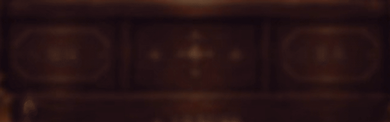
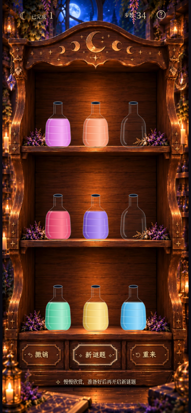
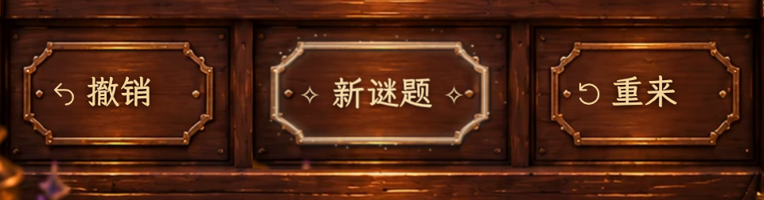

# Milestone 2E · 真实浏览器验收

全部来自生产构建的 Chromium 实际运行画面。390×844 为完整原尺寸截图；
局部图以相同 CSS 视口、3× 像素密度截图。320×568 完整页面可纵向滚动，
画布没有裁切或拉伸。单水晶为合法 35 步解，双水晶为合法 34 步解。

## 动态机关

[完整页面 MP4（约 8 秒，30 fps）](milestone2e-mechanism.mp4)

下方 GIF 是同一次实时录屏的底部局部放大（20 fps），并非设计图或生成动画。
包含关闭结算后的木板翻转、实体侧缘、边框亮起、数个星尘生命周期和点击新谜题后的翻回。

## 游戏与手机布局

[普通游戏 390×844](milestone2e-game-390x844.png) ·
[激活状态 390×844](milestone2e-active-390x844.png) ·
[360×640](milestone2e-active-360x640.png) ·
[320×568（完整滚动页面）](milestone2e-active-320x568.png)

## 字体、光效与对齐

[三个木板高清局部](milestone2e-buttons-detail.png) ·
[中央浅金光与星尘](milestone2e-magic-detail.png) ·
[键盘焦点](milestone2e-focus-detail.png) ·
[翻转中途侧缘](milestone2e-turn-detail.png) ·
[中心参考线调试图](milestone2e-alignment-guides.png)

调试图：青色十字为木板中心，粉色上下线为文字行框。参考线仅由截图脚本临时添加，
没有进入游戏代码。翻转中途截图暂停真实 CSS 动画于 210ms；录屏使用连续实时时间。

## 羊皮纸新字体

[单水晶 390×844](milestone2e-settlement-single-390x844.png) ·
[双水晶 390×844](milestone2e-settlement-double-390x844.png) ·
[360×640](milestone2e-settlement-360x640.png) ·
[320×568](milestone2e-settlement-320x568.png) ·
[桌面 1280×900](milestone2e-settlement-1280x900.png)

单、双水晶的纸张尺寸相同。标题使用霞鹜臻楷，说明文字使用思源宋体；纸张和水晶素材未变。
