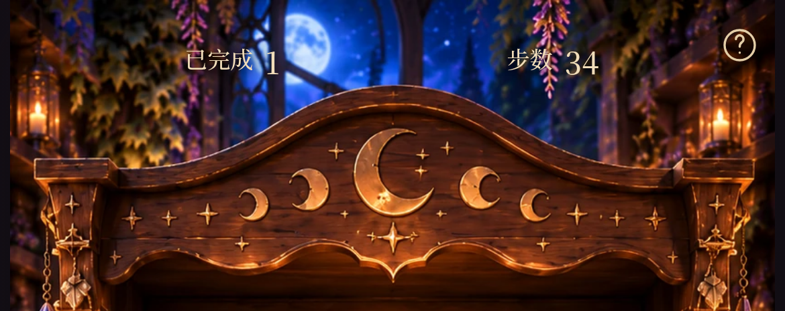
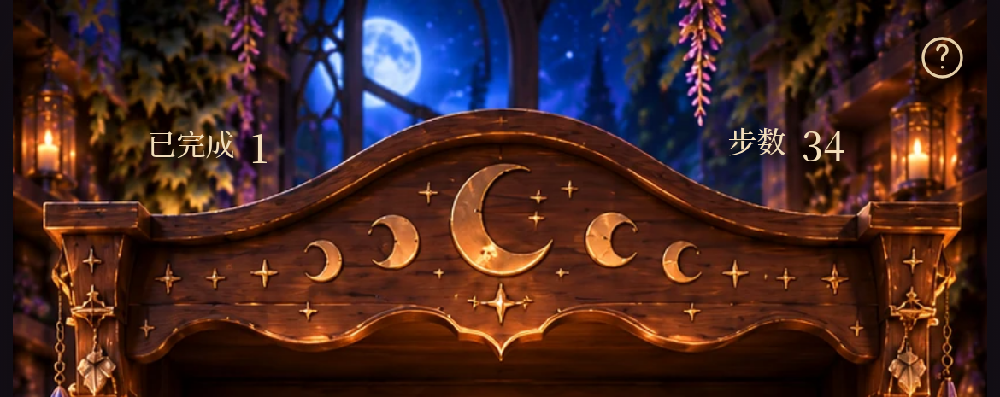
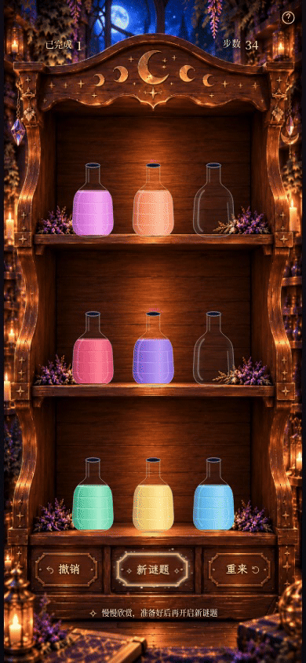

# Milestone 2E Small Visual Patch · 实机浏览器预览

本轮仅调整柜顶 HUD 落位和中央按钮星尘。图片来自本地生产构建的真实 Chromium 页面；背景、瓶子、边框、字体、按钮及帮助界面均沿用现有版本。

## 完整画面对比

同一预设、同一合法解法完成后的排列：已完成 1，步数 34，结算已关闭。前后均无 hover / focus。静态截图将实际 CSS 粒子动画暂停在相同的 2200ms 时间点，以便比较；短片保持实时播放。

| 视口 | 调整前 | 调整后 |
| --- | --- | --- |
| 390×844 | [完整页面](milestone2e-small-before-390x844.png) | [完整页面](milestone2e-small-after-390x844.png) |
| 360×640 | [完整页面](milestone2e-small-before-360x640.png) | [完整页面](milestone2e-small-after-360x640.png) |

## 顶部肩部留白

HUD 依据 841×1870 背景的拱冠肩部留白分别落位，中心落在原图 (168,126) / (668,123)。外柱顶部约在 y175，拱冠中央从 y95 起隆起；文字落在两侧斜肩上方，并避开中央月亮。右侧比左侧略高，保留光学校正。

在 390×844 中，两组中心从 (115.29,30.45) / (274.70,30.45) 移至 (81.03,56.88) / (306.69,55.52)。没有改变字体、字号、文案或数字逻辑。

| 调整前（3× 浏览器像素密度） | 调整后（3× 浏览器像素密度） |
| --- | --- |
|  |  |

## 星尘层次

仍为 36 个稳定发射点：27 个细点、6 个较亮光点、3 枚微型四角星。显示缩放从 0.55–0.65 改为 0.9–1，较亮光点/星芒漂移距离增加 40%；其余漂移与全部生命周期、相位保持不变。细点仍占多数，较大的闪点帮助完整手机画面辨认动态。

| 调整前 | 调整后 |
| --- | --- |
|  |  |

截图时分别有 27 / 26 个粒子的计算不透明度大于 0.15。两次边框常驻不透明度均为 **0.94**，边框路径、色彩与亮度未改动。

## 实时动态演示

[390×844 完整画面 MP4（约 5.4 秒）](milestone2e-small-particles.mp4) · [完整画面 GIF](milestone2e-small-particles.gif)

短片由真实 Chromium screencast 帧及其时间戳编码而来，没有拼贴、生成图片或动画时间跳转。MP4 为 30fps，GIF 为 15fps；GIF 的有限色板和视频压缩可能影响极细小光点，原始 PNG 保留静态细节。

## 保留区域核对

[底部按钮调整前](milestone2e-small-before-buttons.png) · [调整后](milestone2e-small-after-buttons.png)

左右按钮内容中心与帮助图标位置前后完全一致。减少动态效果时继续保留静态微光，不运行连续粒子动画。此处为 Chromium 手机模拟视口，尚未验证实体 iOS/Safari。
