# Milestone 3A · 三种炼金瓶与动态药液原型

以下全部来自实际运行的本地生产构建，背景仍是正式 841×1870 木柜。没有裁切概念图制作瓶子，也没有使用独立展示插画代替游戏。圆腹、梨形、棱面各重复三次，按左、中、右列放置。

## 真实混色谜题

[390×844 完整页面](milestone3a-mixed-390x844.png) · [360×640 完整页面](milestone3a-mixed-360x640.png) · [第一层三瓶高清局部](milestone3a-full-detail.png)

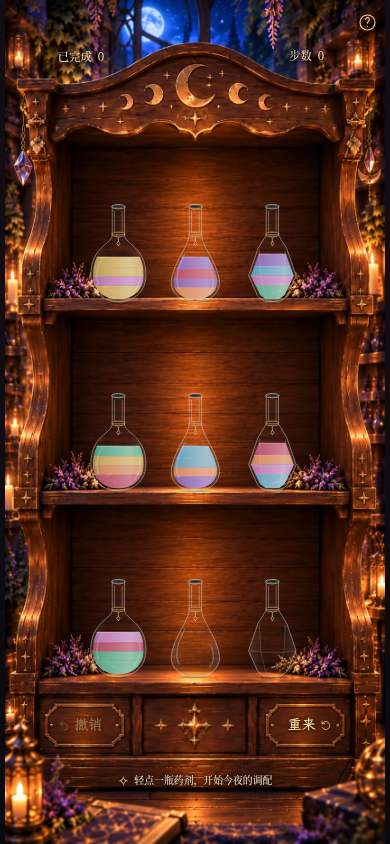

七种颜色仍沿用当前游戏的玫瑰红、紫水晶、薄荷绿、天空蓝、蜂蜜金、珊瑚橙、兰花粉身份，适度降低饱和度。没有改用概念图中的白色药剂，也没有加入特殊闪粉效果。HUD 数字和文字统一字号、字重、行高，并按基线对齐；肩部坐标保留。

## 空瓶 / 半瓶 / 满瓶

每张局部图都是实际木柜中的药瓶，以 3× 浏览器像素密度截取。半瓶指 **2/4 单位**，瓶腹的收窄使实际液面高度并非瓶身高度的一半。相邻同色仍保留细分界。

| 瓶型 | 空瓶 | 半瓶 | 满瓶 |
| --- | --- | --- | --- |
| 圆腹 | 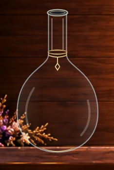 | 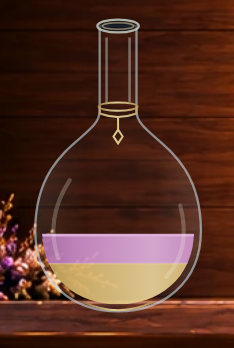 | 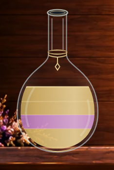 |
| 梨形 | 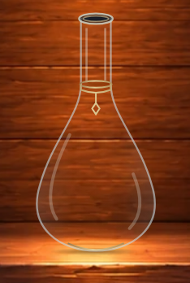 | 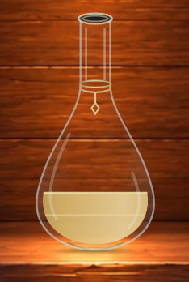 | 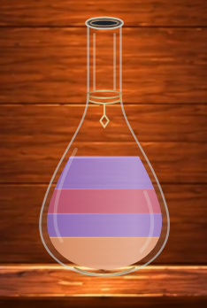 |
| 棱面 | 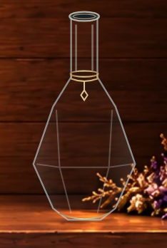 | 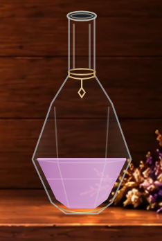 | 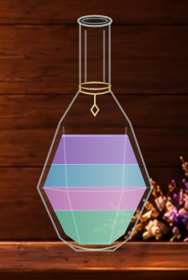 |

来源均为 `moon-1` 预设的合法解法步骤，而非放宽存档校验的展示棋盘：

- 初始状态：[完整棋盘](milestone3a-mixed-390x844.png)。三种满瓶取第 1/2/3 瓶；梨形/棱面空瓶取第 8/9 瓶。
- 完成第 1 步：[完整棋盘](milestone3a-state-1.png)。圆腹/梨形半瓶取第 1/8 瓶。
- 完成第 5 步：[完整棋盘](milestone3a-state-5.png)。圆腹空瓶取第 1 瓶，棱面半瓶取第 9 瓶。

## 实时倒药演示

[完整手机画面 MP4，约 6.2 秒](milestone3a-pouring.mp4) · [完整手机画面 GIF](milestone3a-pouring.gif)

实际点击预设的前 3 步，依次由圆腹、圆腹、棱面瓶倒出，包含上下层之间的流动。视频通过 Chromium screencast 录下 208 帧，按原始时间戳编码，保留正常 920ms 倒药节奏，没有减速、拼贴或生成画面。MP4 为 30fps；GIF 为 20fps、有限色板，细节可对照原始 PNG。

另录制梨形瓶作为来源瓶的同层倒药（加载合法解法的第 10 步状态，然后实际点击下一步），对应预设中第 2 瓶向第 1 瓶倒药：

[梨形倒药 MP4](milestone3a-pear-pouring.mp4) · [梨形倒药 GIF](milestone3a-pear-pouring.gif)

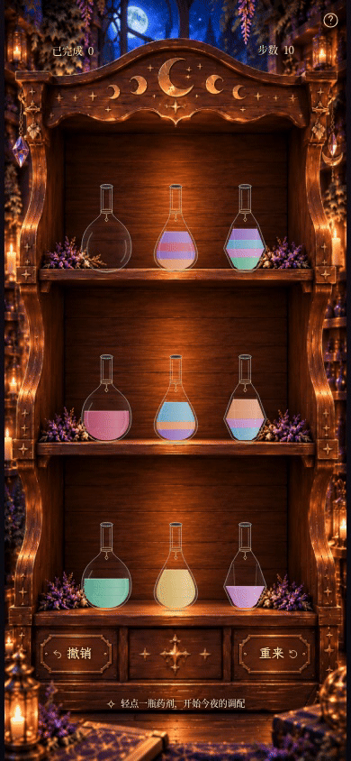

液面始终按屏幕重力方向保持水平；剩余液量减少时，来源瓶进一步倾斜，将顶层液面接至下侧瓶唇。流线从该瓶唇落入目标瓶口，目标瓶内流线与波纹裁剪在其独立瓶腔内。旋转的玻璃与药液分别绘制，回位时继续使用同一瓶型。

### 固定视口关键帧

以下用实际浏览器动画时钟暂停截取，均为同一次上层圆腹瓶向下层梨形瓶倒药：

| 阶段 | 实际页面 |
| --- | --- |
| 选中、微浮起 | [选中](milestone3a-selected.png) |
| 悬浮移动，120ms | [悬浮](milestone3a-flight-120ms.png) |
| 开始倒药，320ms | [瓶口流出](milestone3a-flight-320ms.png) |
| 继续倒药，540ms | [来源减少、接收液面升高](milestone3a-flight-540ms.png) |
| 返回途中，790ms | [回位途中，液面仍水平](milestone3a-flight-790ms.png) |
| 已落回原位，1040ms | [最终状态](milestone3a-flight-1040ms.png) |

三种来源瓶的倾斜状态：[圆腹](milestone3a-pour-step0.png) · [梨形](milestone3a-pour-step10.png) · [棱面](milestone3a-pour-step2.png)。另有[下层圆腹向上层倒药](milestone3a-pour-step1.png)。

## 验证与范围

**81 项单元测试、90 项 Playwright 浏览器测试、生产构建全部通过。**

新增验证涵盖四层可读性、不同倾角的二维液量守恒、顶层液面接瓶唇、真实 SVG 分界水平、流线起点、接收液面上升、三种来源瓶、左右倾倒及 HUD 同字体基线；原有规则、存档、撤销、结算奖励、木柜布局、翻板和减少动态效果回归均通过。截图/录制没有浏览器页面错误。

本轮是验证方向的 SVG 原型。玻璃与黄铜仍是简洁矢量表现，尚未达到参考图的精细材质。药液是二维面积与即时平衡近似，没有真实三维体积、惯性晃动或折射；实体 Safari/iOS 和低端设备尚未验证。保持 920ms、原有提交时机与游戏逻辑，未扩展为九只最终瓶子。
