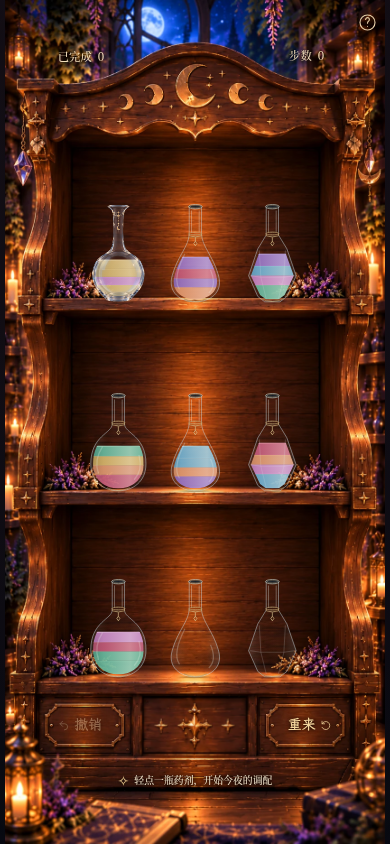
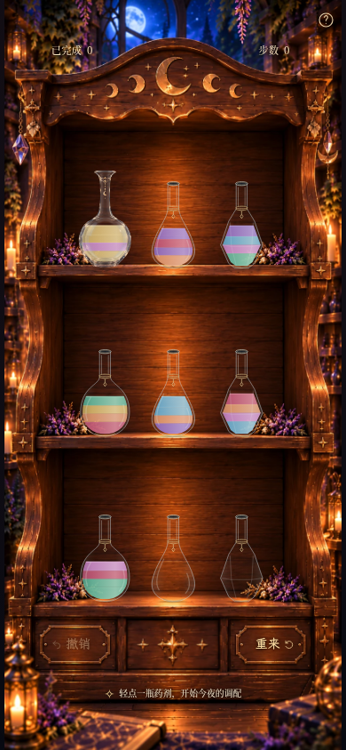
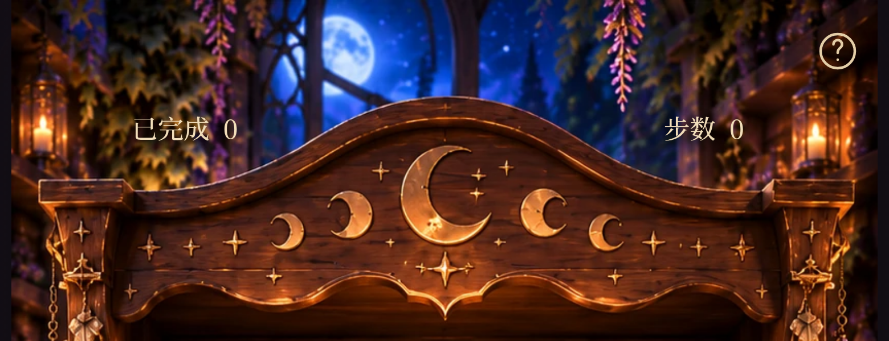

# Milestone 3B Patch · 真实浏览器验收

本轮仅校准 HUD、将 index 0 以瓶底为锚点放大 13%，并温和削弱冷白玻璃和底部亮环。
原 PNG / WebP 未改动；其他八瓶、药液、920ms 倒药时间线和游戏数据逻辑不变。

以下均为实际生产构建的 Chromium 游戏截图，完整页为 390×844、DPR 1；局部为同一视口下 DPR 3/4 的浏览器裁剪。
使用已有合法预设及解法历史，不合成瓶子或药液。优化前图片来自基准 `6c89df1`，同视口、同谜题状态。

## 优化前 / 后

| 优化前 | 优化后 |
| --- | --- |
|  |  |

## 静置状态

| index 0 状态 | 完整页面 | 局部特写 |
| --- | --- | --- |
| 空瓶 | [390×844](milestone3b-patch-state-5-390x844.png) | [局部](milestone3b-patch-state-5-detail.png) |
| 1 单位浅金 | [390×844](milestone3b-patch-state-4-390x844.png) | [局部](milestone3b-patch-state-4-detail.png) |
| 2 单位：金 / 紫 | [390×844](milestone3b-patch-state-1-390x844.png) | [局部](milestone3b-patch-state-1-detail.png) |
| 4 单位：金 / 紫 / 金 / 金 | [390×844](milestone3b-patch-state-0-390x844.png) | [局部](milestone3b-patch-state-0-detail.png) |
| 1 单位紫色 | [390×844](milestone3b-patch-state-11-390x844.png) | [局部](milestone3b-patch-state-11-detail.png) |
| 4 层相邻异色：金 / 蓝 / 金 / 玫瑰 | [390×844](milestone3b-patch-four-layers-390x844.png) | [局部](milestone3b-patch-four-layers-detail.png) |

四层异色使用现有 moon-2 谜题（四个相邻色带，非四种互不重复颜色）。其他状态来自 moon-1 的合法解法步骤。

[360×640 页面](milestone3b-patch-360x640.png)。较短视口沿用原有纵向滚动策略。

## 实际倒药录像

[完整页面 MP4](milestone3b-patch-pour.mp4) · [完整页面 GIF](milestone3b-patch-pour.gif)

连续两次真实触摸：index 0 → 7（正式瓶作为来源），随后 index 6 → 0（正式瓶作为接收）。
录制 140 个真实浏览器 screencast 帧，采样跨度约 3.86 秒；含结尾停留的 MP4 为 4.13 秒。按实际帧时间编码，没有放慢游戏时间线。

[来源瓶局部](milestone3b-patch-source-detail.png) · [接收瓶局部](milestone3b-patch-receiver-detail.png)

固定视口下的关键帧使用浏览器时钟控制确定拍摄时刻，不触发布局重排：
[选中](milestone3b-patch-selected.png) →
[120ms](milestone3b-patch-flight-120ms.png) →
[320ms](milestone3b-patch-flight-320ms.png) →
[540ms](milestone3b-patch-flight-540ms.png) →
[790ms](milestone3b-patch-flight-790ms.png) →
[回位](milestone3b-patch-flight-1040ms.png)。

## 视觉判断与限制

瓶底仍接触同一木板位置，瓶口向上展开；空瓶中央可见木纹，金饰和月牙仍清楚。
淡金药液边缘仍会被原画反光轻微提亮，但冷白亮环已收敛。只作二维颜色与透明度处理，
没有模拟真实折射或随场景照明变化的反射；原画反光仍随瓶身旋转。实体 iOS/Safari 尚未验证。

验证：85 项单元测试、96 项浏览器测试通过，生产构建通过。
