# Milestone 3B Visual Polish II · 原版 / 暖烛光对照

本轮默认展示暖烛光实验，原版玻璃实现完整保留。运行游戏时使用 `?glass=original` 查看上一版玻璃，
`?glass=candle` 或无参数查看暖光版。该参数只选渲染，不写存档，没有玩家设置入口；切换后需重新加载页面。
两版均保持原先 13% 放大、同一瓶底落点、瓶腔和 920ms 倒药时序。

## 同条件完整页面

以下两张均来自最新生产构建，视口 **390×844、DPR 1**，同一 moon-2 初始谜题，浏览器时钟推进至同样的 **2200ms**，
两版只切换玻璃材质。药液、木柜、HUD、相邻八瓶、相机和裁剪完全相同。

| 保留的 3B Patch 玻璃 | 暖烛光实验 |
| --- | --- |
| 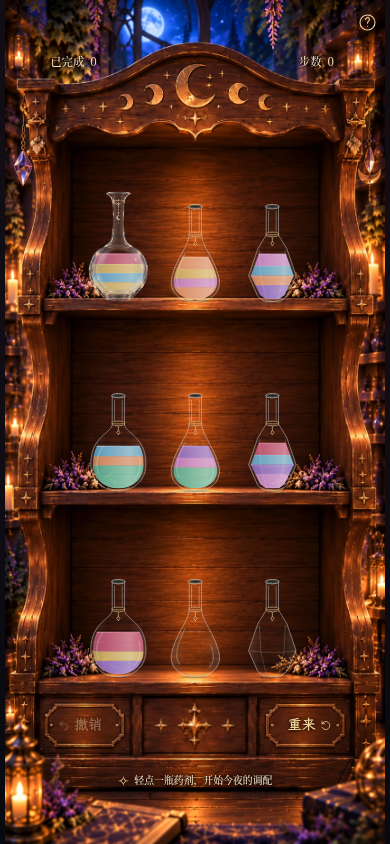 |  |

## 各状态局部对照

局部为同一 390×844 页面以 DPR 4 真实浏览器裁剪，位置与尺寸一致，不是抠图合成。
每组同时提供完整木柜页面，便于判断实际游戏中的融合度。

### 空瓶：木纹透视

[原版完整页](milestone3b-polish2-empty-original-390x844.png) · [暖光完整页](milestone3b-polish2-empty-candle-390x844.png)

| 原版 | 暖光 |
| --- | --- |
| 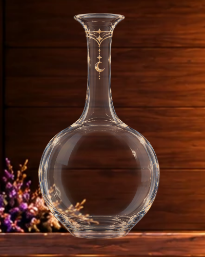 |  |

### 1 单位浅金

[原版完整页](milestone3b-polish2-gold-original-390x844.png) · [暖光完整页](milestone3b-polish2-gold-candle-390x844.png)

| 原版 | 暖光 |
| --- | --- |
| 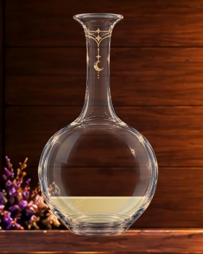 | 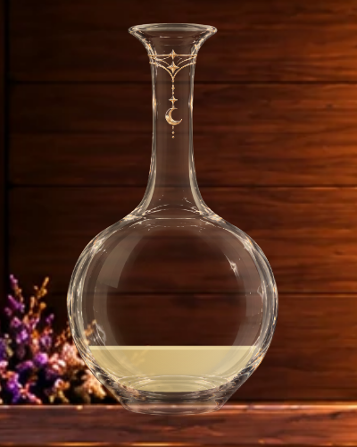 |

### 1 单位紫色

[原版完整页](milestone3b-polish2-purple-original-390x844.png) · [暖光完整页](milestone3b-polish2-purple-candle-390x844.png)

| 原版 | 暖光 |
| --- | --- |
| 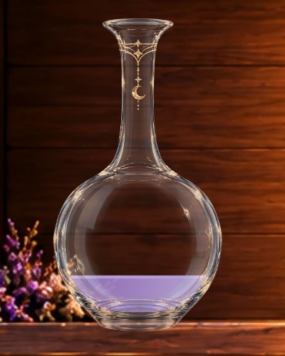 |  |

### 1 单位蓝色

[原版完整页](milestone3b-polish2-blue-original-390x844.png) · [暖光完整页](milestone3b-polish2-blue-candle-390x844.png)

| 原版 | 暖光 |
| --- | --- |
| 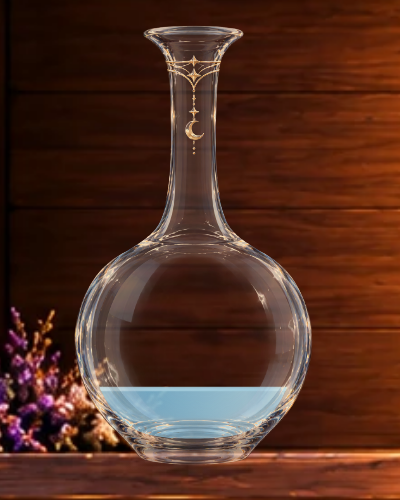 | 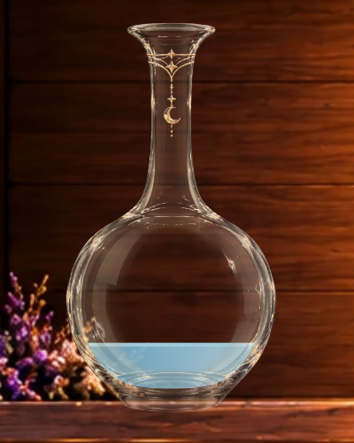 |

### 2 单位：金 / 兰花粉

[原版完整页](milestone3b-polish2-two-colors-original-390x844.png) · [暖光完整页](milestone3b-polish2-two-colors-candle-390x844.png)

| 原版 | 暖光 |
| --- | --- |
| 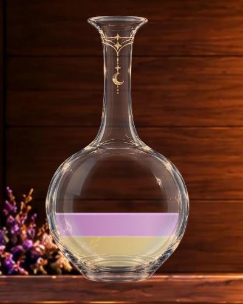 | 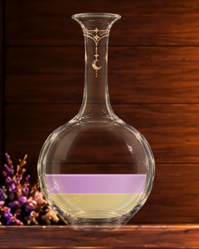 |

### 4 层相邻异色：金 / 蓝 / 金 / 玫瑰

[原版完整页](milestone3b-polish2-four-layers-original-390x844.png) · [暖光完整页](milestone3b-polish2-four-layers-candle-390x844.png)

| 原版 | 暖光 |
| --- | --- |
|  | 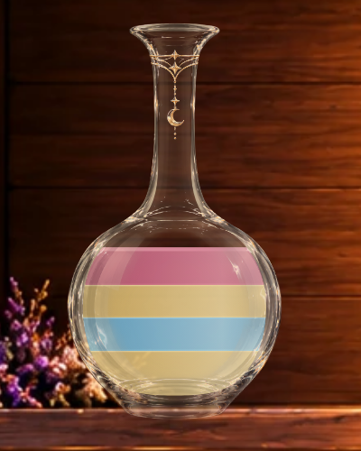 |

所有状态使用现有合法谜题和解法历史：moon-1 步骤 5 / 4 / 11 / 1 对应空瓶 / 浅金 / 紫色 / 双色；
蓝色来自 moon-4 第 4 步；四层来自 moon-2 初始局面（四条相邻异色，非四种完全不同颜色）。

## HUD 调整前后

左图为基准提交 `d31f73d` 的真实浏览器截图；右图保留原版玻璃，只使用本轮 HUD 位置，仍是同一 moon-2 初始局面。

| 原 HUD | 新 HUD（原版玻璃） |
| --- | --- |
|  |  |

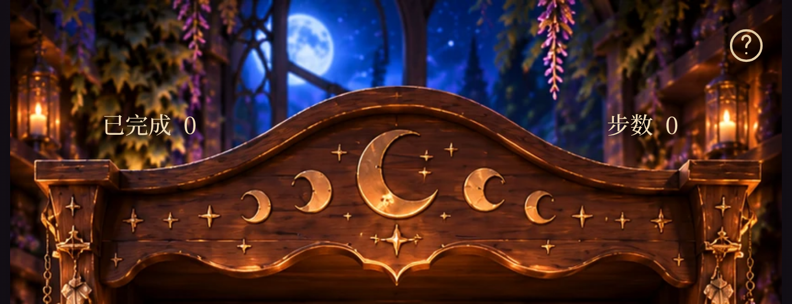

| 390×844 实测 | 原 HUD | 新 HUD |
| --- | --- | --- |
| 左组中心 | (81.125, 56.875) | (73.53125, 61.625) |
| 右组中心 | (308.859375, 56.875) | (316.453125, 61.625) |
| 左右容器顶边 | 48.90625 | 53.65625 |
| 容器高度 | 15.9375 | 15.9375 |

两组共同下移 **4.75px**、分别向外约 **7.59px**。新中心平均 x194.9921875，相对于柜体中轴 x195 的偏差为 **0.0078125px**，
属于 Chromium 的 1/64px 布局舍入；纵向坐标完全一致。[当前浏览器测量数据](milestone3b-polish2-measurements.json)。

主视口选用 **18% / 82%、top 7.3%**，而非更外侧的建议初值，以保留三位数字与柜侧雕饰之间的留白。
320px 窄屏仍用 20% / 80% 镜像中心避开固定 44px 帮助目标，统一高度保持 7.3%；字体、字号、内部间距和帮助入口均未修改。
[360×640](milestone3b-polish2-360x640.png) · [320×568](milestone3b-polish2-320x568.png) · [1280×900](milestone3b-polish2-1280x900.png)。短屏沿用原有纵向滚动。

## 真实倒药录制

[MP4](milestone3b-polish2-pour.mp4) · [GIF](milestone3b-polish2-pour.gif)

139 个实际 screencast 帧，时间跨度约 3.885 秒；编码后的 390×844 MP4 为 4.13 秒（含结束停留），按真实时间播放。
顺序为 index 0 → 7（正式瓶作为来源），随后 index 6 → 0（正式瓶作为接收）。没有修改游戏时序或拼贴动画。

[来源瓶局部](milestone3b-polish2-source-detail.png) · [接收瓶局部](milestone3b-polish2-receiver-detail.png) ·
[选中](milestone3b-polish2-selected.png) · [飞行 320ms](milestone3b-polish2-flight-320ms.png) ·
[倾倒 540ms](milestone3b-polish2-flight-540ms.png) · [回位](milestone3b-polish2-flight-1040ms.png)。
关键帧使用固定视口和浏览器时钟定位，实时录像使用正常浏览器时钟。

## 验收判断与限制

- 暖光版降低颈肩冷白细线的锐利度，以香槟金反光为主，右侧保留少量冷反射；不新增不透明暖色覆盖层。
- 原版预览的瓶身/木板裁剪与基准截图像素相同；同条件材质对照中，样板瓶区域外的像素相同。
- 独立 SVG 药液的颜色、面积、边界和几何未改动。选取液体中央小块像素比较，三种单色药液的平均 RGB 每通道变化约 0–1.4/255；
  这只说明该清透区域基本未被染色，并不表示玻璃边缘所有像素不变。
- 原始金饰叠加层仍使用原图；没有模糊月牙、细链或星形层。瓶底亮环额外衰减，保留玻璃厚度与接触点。
- 仍是二维插画反光，反光随瓶子旋转，未模拟真实折射或场景动态照明。实际手机低端 GPU 与 Safari/iOS 尚未验证。

验证结果：**85 项单元测试、98 项 Playwright 浏览器测试全部通过；生产构建通过。**
