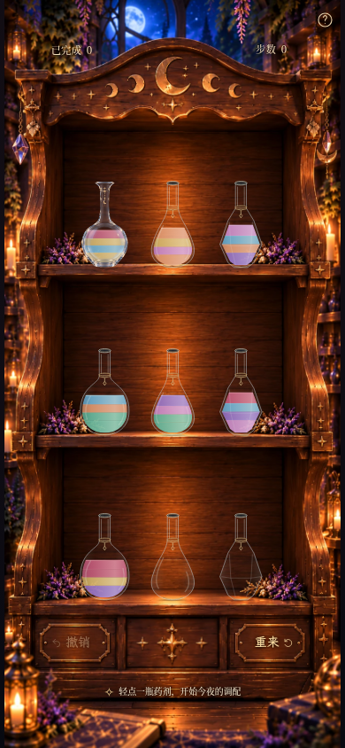
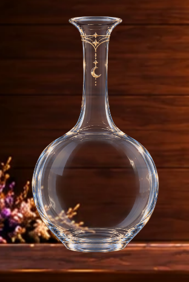
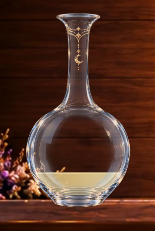
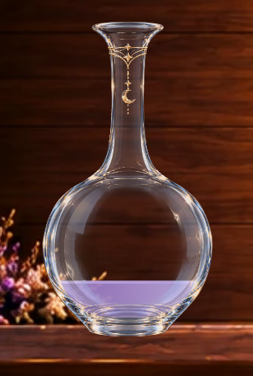
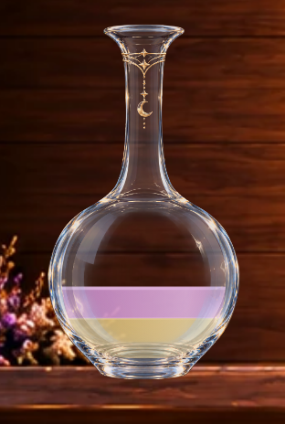
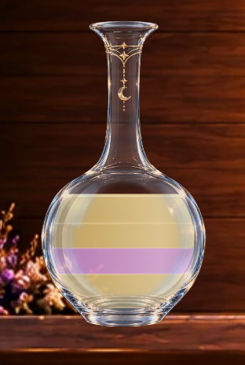
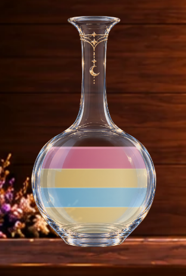
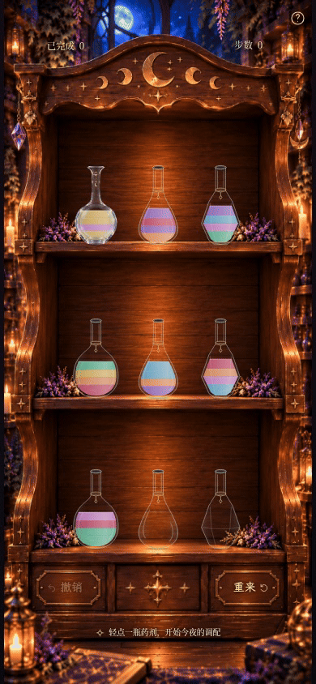
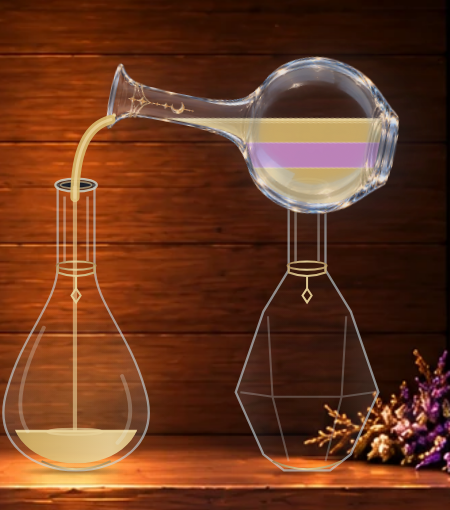
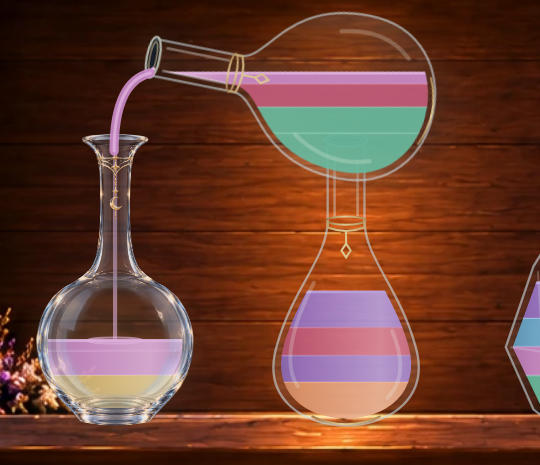

# Milestone 3B · 第一只月影玻璃样板瓶

仅左上角 **index 0** 使用用户提供的玻璃美术。其他八只仍为 3A SVG 原型，包括另两只圆腹瓶。所有验收图片来自真实 Chromium 游戏页面；没有以参考图或静态产品合成图代替游戏。

## 完整游戏画面

[390×844 · 四层异色分界](milestone3b-four-layers-390x844.png) · [390×844 · 浅金满瓶](milestone3b-state-0-390x844.png) · [360×640](milestone3b-360x640.png)

四层异色分界使用真实 `moon-2` 初始预设：从底到顶为蜂蜜金、天空蓝、蜂蜜金、玫瑰红。其余静态/动态记录使用 `moon-1` 及其合法解法历史；没有改变游戏规则或存档校验。

## 空瓶、1/2/4 单位与透明度

局部图为实际木柜中该瓶的 4× 浏览器像素密度截图。点击完整页面可核对真实棋盘状态。四单位浅金满瓶含相邻同色层，仍保留细分界；另一张满瓶图显示四条相邻异色带。

| 状态 | 实际局部 | 完整页面及来源 |
| --- | --- | --- |
| 空瓶、深色木纹透视 |  | [moon-1 第5步](milestone3b-state-5-390x844.png) |
| 1 单位蜂蜜金 |  | [moon-1 第4步](milestone3b-state-4-390x844.png) |
| 1 单位紫水晶 |  | [moon-1 第11步](milestone3b-state-11-390x844.png) |
| 2 单位不同颜色 |  | [moon-1 第1步](milestone3b-state-1-390x844.png)，蜂蜜金＋兰花粉 |
| 4 单位浅金混色 |  | [moon-1 初始](milestone3b-state-0-390x844.png) |
| 4 层相邻异色 |  | [moon-2 初始](milestone3b-four-layers-390x844.png) |

附件瓶腹中央本已透明，问题集中在近乎不透明的瓶颈与瓶肩。现使用可撤回的 SVG 透明度遮罩和暖色细节保留层，原图与 WebP 像素均未改写。空瓶能看见木纹，金属/月牙仍保留，药液位于玻璃反光之后。

实际浏览器透明背景测量的中央腹部平均 Alpha 约 **1.9%**、中央瓶颈约 **36.1%**；这不是全瓶统一透明度，轮廓和金饰保持更高不透明度。原图分析、采样区域及合成方法见 [素材说明](../../assets/moon-glass.md)。

## 真实倒药动画

[390×844 完整页面 MP4，约 3.8 秒](milestone3b-pouring.mp4) · [完整页面 GIF](milestone3b-pouring.gif)

连续实际点击 `moon-1` 的前两步：

1. 正式瓶 index 0 向下层梨形瓶 index 7 倒出。
2. 下层原型瓶 index 6 向正式瓶 index 0 倒入。

录像来自 **118 个真实浏览器 screencast 帧**，按原始时间戳编码，没有动画时间跳转、拼贴或人为减速。保留 **920ms** 单次倒药时序，640ms 仅提交一次。MP4 为 30fps，GIF 为 20fps；GIF 色板及视频压缩会损失极细小的金饰/反光细节，请结合 PNG 查看。

[正式瓶作为来源，完整页面](milestone3b-pour-0.png) · [来源局部](milestone3b-source-detail.png)

[正式瓶作为接收，完整页面](milestone3b-pour-1.png) · [接收局部](milestone3b-receiver-detail.png)

### 固定视口关键帧

以下暂停的是实际浏览器动画时钟，用于观察同一次正式瓶倒出过程；视频本身正常播放。

[选中浮起](milestone3b-selected.png) · [120ms 悬浮](milestone3b-flight-120ms.png) · [320ms 流出](milestone3b-flight-320ms.png) · [540ms 液量变化](milestone3b-flight-540ms.png) · [790ms 返回](milestone3b-flight-790ms.png) · [1040ms 已落位](milestone3b-flight-1040ms.png)

## 结果与限制

**85 项单元测试、96 项浏览器测试、生产构建全部通过。** 单独验证 index 0 资产选择、等比映射、瓶口/接触点、静置/来源/接收素材一致、回位/撤销/刷新和减少动态效果；原有规则、晶石、结算、存档及其他布局回归通过。截图与录像未记录到页面错误。

样板使用原图的精细玻璃、瓶口、金饰和月牙，液体保持独立 SVG 渲染。它验证了现有系统可以承载这种混合美术方案，但尚不模拟真实折射或动态光照：图内反光随瓶身旋转，边缘仍会略微提亮浅色药液。实际手机画面中月牙和细链仅占少量像素；实体 iOS/Safari 及低端设备性能尚未验证。

原始 PNG、无损 WebP、遮罩参数和几何均有保留，方便验收后局部调整。本轮到此停止，未替换其他八瓶，也未制作新的药液主题或特效。
