# Milestone 3C · 暖金星月瓶与 HUD 光学对照

以下均来自实际生产构建的 Chromium 游戏页面；完整手机截图为 **390×844、DPR1**，高清局部为同视口 DPR4 浏览器裁剪。
没有重新生成瓶子、拼贴药液或使用概念整图替代游戏。附件只含一张 PNG，装饰为规整的“星—珠—月—珠—星”，没有长链。

## 新旧同状态完整页面

同一 moon-2 初始棋盘、同一视口、相同 2200ms 浏览器时间点；仅内部材质参数不同。

| 旧版 3B 暖光样板 | 新版 3C 暖金星月瓶 |
| --- | --- |
| 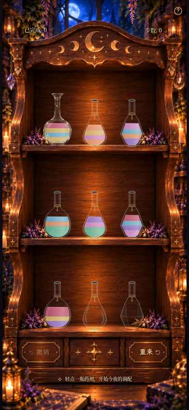 | 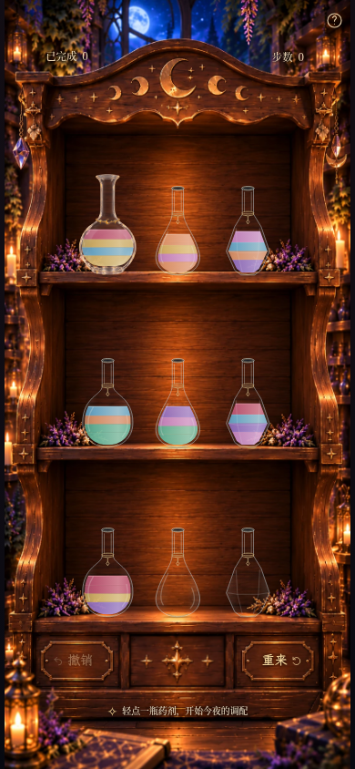 |

新瓶仍只用于左上角 index 0，其他八只 3A 原型同框保留。
其余区域对照的最大 RGB 通道差为 2/255（浏览器合成舍入），其他瓶型/配色/布局代码没有改动。

内部预览与回退（无玩家设置、不写存档，更换后重载页面）：

- 默认 / `?glass=star-moon`：新图及重新测量的瓶腔。
- `?glass=candle`：完整保留的上一版暖光美术及旧瓶腔。
- `?glass=original`：3B 原版美术及旧瓶腔。

## 液量和透明度

### 空瓶：木纹可直接透出

[新版完整页](milestone3c-empty-new-390x844.png) · [旧版完整页](milestone3c-empty-legacy-390x844.png)

| 旧版局部 | 新版局部 |
| --- | --- |
| 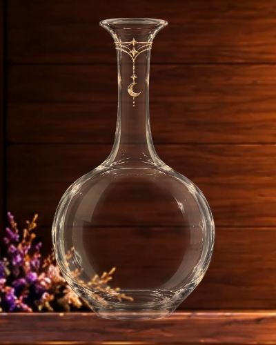 | 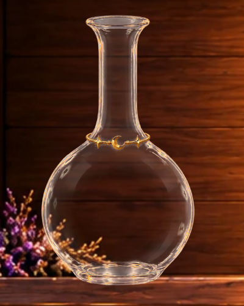 |

### 1 单位浅金

[新版完整页](milestone3c-gold-new-390x844.png) · [旧版完整页](milestone3c-gold-legacy-390x844.png)

| 旧版局部 | 新版局部 |
| --- | --- |
| 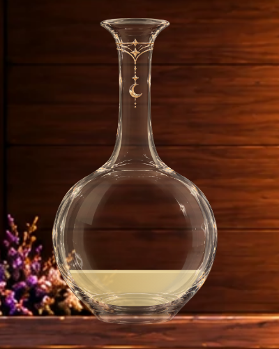 | 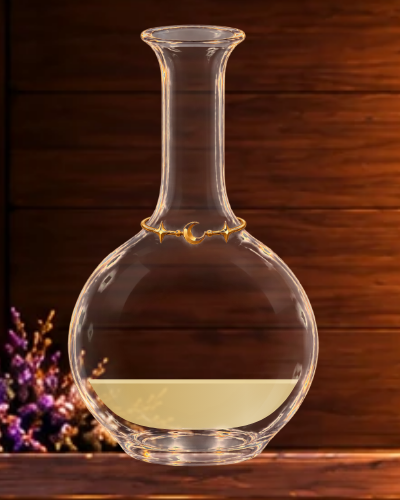 |

### 1 单位紫色

[新版完整页](milestone3c-purple-new-390x844.png) · [旧版完整页](milestone3c-purple-legacy-390x844.png)

| 旧版局部 | 新版局部 |
| --- | --- |
|  | 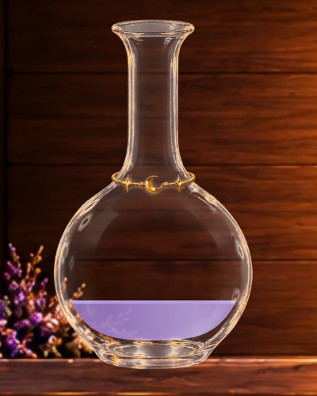 |

### 2 单位：金 / 兰花粉

[新版完整页](milestone3c-two-colors-new-390x844.png) · [旧版完整页](milestone3c-two-colors-legacy-390x844.png)

| 旧版局部 | 新版局部 |
| --- | --- |
| 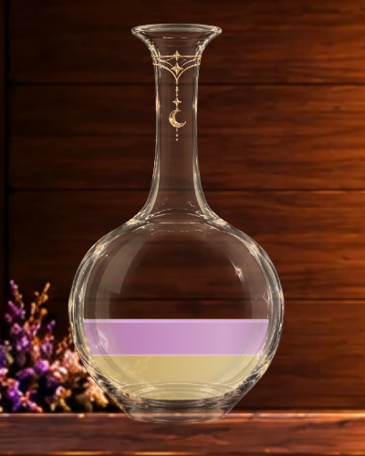 | 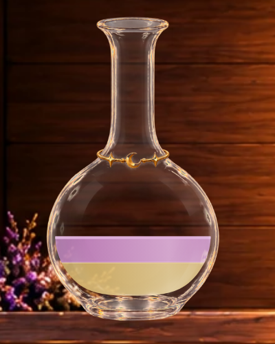 |

### 4 单位相邻混色：金 / 蓝 / 金 / 玫瑰

[新版完整页](milestone3c-four-layers-new-390x844.png) · [旧版完整页](milestone3c-four-layers-legacy-390x844.png)

| 旧版局部 | 新版局部 |
| --- | --- |
| 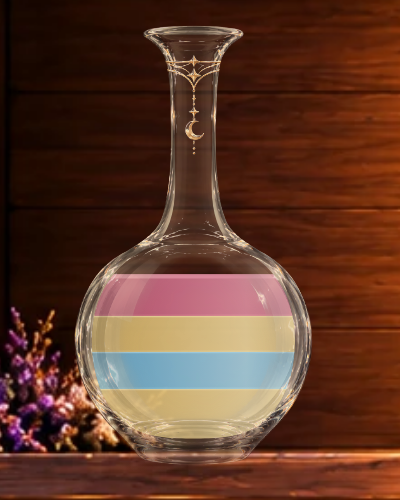 | 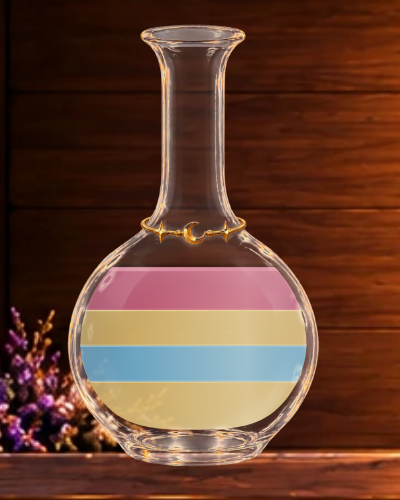 |

### 补充：1 单位蓝色

[新版完整页](milestone3c-blue-new-390x844.png) · [旧版完整页](milestone3c-blue-legacy-390x844.png)

| 旧版局部 | 新版局部 |
| --- | --- |
| 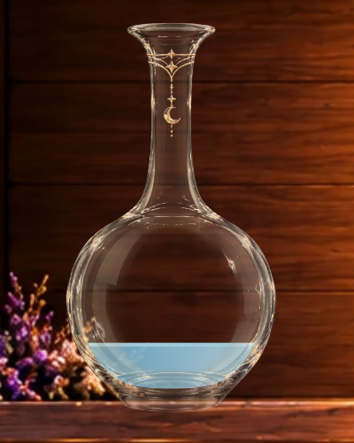 | 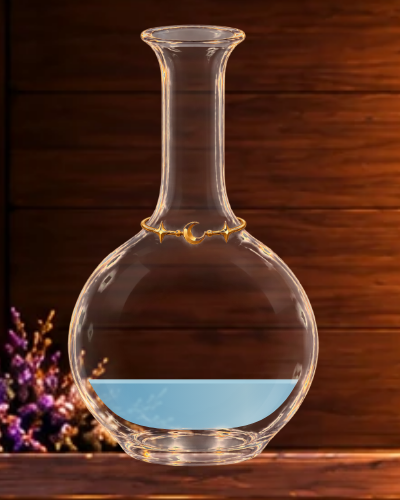 |

所有截图使用已有合法预设与解法历史：moon-1 的第 5/4/11/1 步对应空瓶/浅金/紫色/双色；moon-4 第4步提供蓝色；moon-2 初始提供四层混色。
“四层”采用实际棋盘中的金/蓝/金/玫瑰，包含三种颜色，未伪造四种独色存档或新增关卡。

### 浅色诊断背景

以下仍为浏览器实际绘制，仅在截图上下文临时隐藏木柜插画、设浅米色底，用于检查透明边缘；正式游戏不使用这个背景。

| 空瓶 | 浅金药液 |
| --- | --- |
| 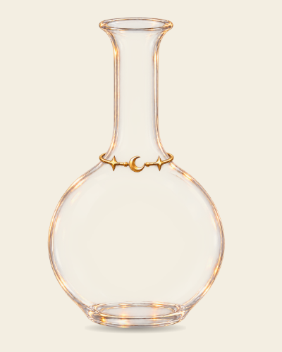 | 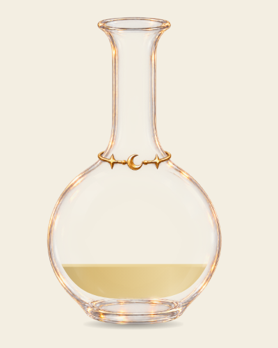 |

原 PNG 的中央黑色区域实测平均 alpha 仅 **0.377/255**，确实透明；瓶颈平均 alpha 则为 **153.40/255**。
新 WebP 清理游离 matte、降低中性白色玻璃区域的过高 Alpha；所有保留的可见 RGB 字节仍与原图一致。
没有沿用旧瓶的暖色矩阵、旧透明度遮罩或底部衰减滤镜，也没有删除一整块圆形瓶腹。
[素材测量、处理与新坐标说明](../../assets/star-moon-glass.md)。

## HUD：只移动右侧可见内容

两组外层锚点继续为 **18% / 82%、top 7.3%**（320px 窄屏保持既有 20% / 80% 回退）。
字体、字号、字重、字距、基线排版和 6px 内间距不变；左侧与帮助入口不移动。
右侧新增内层整体偏移，最终选 **向下 1 CSS px**，保留 0 / 1.5px 供视觉验收。
0px 顶部截图与基准 `440047a` 的顶部截图像素完全一致。

| 内容偏移 | 完整页面 | 顶部高清局部 |
| --- | --- | --- |
| 0px（原位置） | [完整页](milestone3c-hud-0px-390x844.png) | [局部](milestone3c-hud-0px-detail.png) |
| 1px（本轮默认） | [完整页](milestone3c-hud-1px-390x844.png) | [局部](milestone3c-hud-1px-detail.png) |
| 1.5px（备选） | [完整页](milestone3c-hud-1.5px-390x844.png) | [局部](milestone3c-hud-1.5px-detail.png) |

| 原位置 | 下移 1px | 下移 1.5px |
| --- | --- | --- |
| 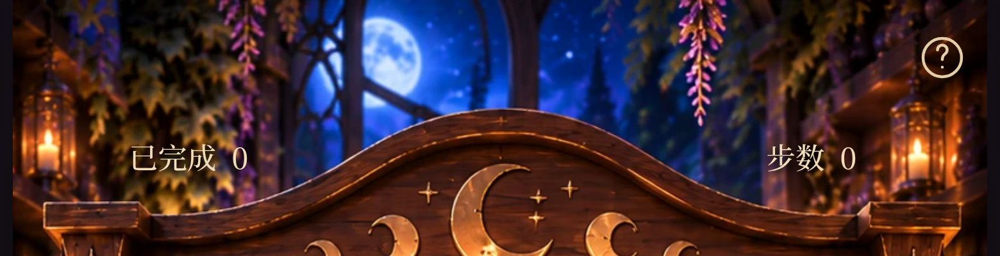 |  | 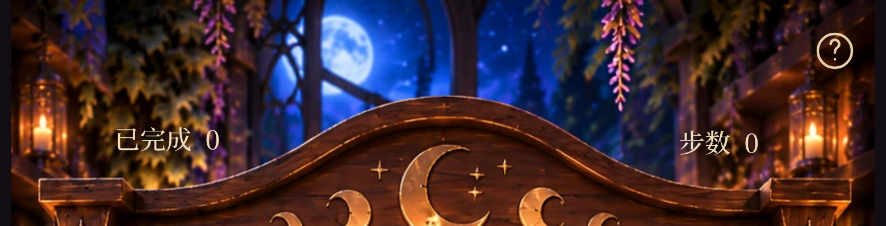 |

390×844 中，三组方案的外层左中心均为 **(73.53125,61.625)**，右中心均为 **(316.453125,61.625)**；
两容器顶边均为 **53.65625px**、高度均为 **15.9375px**。只有右侧内容中心 y 从61.625变为62.625或63.125。
[容器与内容实测数据](milestone3c-hud-measurements.json)。

另用同场景隐藏文字的浏览器截图作基底，提取可见亮色笔画（不把背景和暗色投影计入），对本页“0/0”数字样本得到：

| 内容偏移 | 左笔画亮度加权 y | 右笔画亮度加权 y |
| --- | --- | --- |
| 0px | 61.94 | 61.41 |
| 1px | 61.94 | 62.38 |
| 1.5px | 61.94 | 62.86 |

[笔画范围与近似重心数据](milestone3c-hud-ink.json)。1px 是轻微、折中的校正；这个亮度指标受字形与背景影响，
不是所有数字组合的普遍光学标准，最终仍以截图观感为准。

## 真实浏览器倒药

[MP4](milestone3c-pour.mp4) · [GIF](milestone3c-pour.gif)

141 个真实 screencast 帧，采样跨度约 **3.929 秒**；MP4 **390×844 / 30fps / 4.07秒**（含结尾停留）。
第一次 index 0 → 7 展示新瓶作为来源；第二次 index 6 → 0 展示新瓶接收。
实际浏览器触摸、水平液面、真实瓶口出流、接收液量上升和回位，没有静态拼接或放慢时间线。

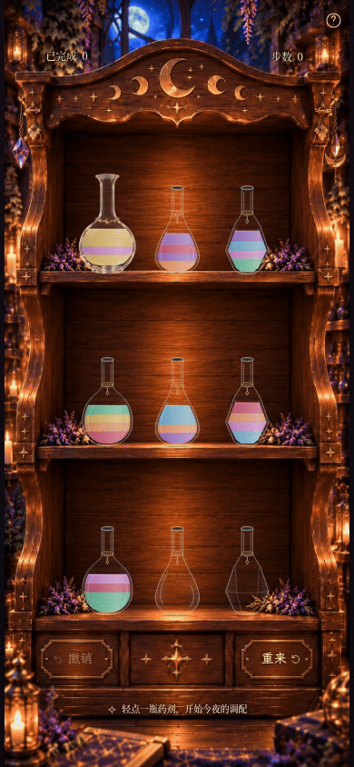

[来源瓶完整页](milestone3c-pour-0.png) · [接收瓶完整页](milestone3c-pour-1.png) ·
[来源瓶特写](milestone3c-source-detail.png) · [接收瓶特写](milestone3c-receiver-detail.png) ·
[选中](milestone3c-selected.png) → [飞行320ms](milestone3c-flight-320ms.png) →
[倾倒540ms](milestone3c-flight-540ms.png) → [回位1040ms](milestone3c-flight-1040ms.png)。
关键帧用固定视口及浏览器时钟定位；视频用真实运行时钟。

[360×640](milestone3c-360x640.png) · [320×568](milestone3c-320x568.png) · [1280×900](milestone3c-1280x900.png)。
较短屏幕继续采用原有纵向滚动。

## 实际限制

这是原图透明玻璃与独立 SVG 药液的二维合成，不模拟背景折射或三维光源；原画反光会随瓶身一起旋转。
小屏幕上的五件金饰只有数个像素，高清局部更容易辨认；边缘仍保留原画少量亮色反射。
未发现明显外部游离杂色，但不宣称像素级完美去背。实体 iOS/Safari 与低端 GPU 性能尚未验证。

验证结果：**85 项单元测试、98 项 Playwright 浏览器测试全部通过，生产构建及 `git diff --check` 通过**。
