# Milestone 3D · 药液材质实验与新旧对照

默认 / `?liquid=polished` 使用新版；`?liquid=legacy` 恢复 3C 的原始配色和药液绘制。
这是页面级内部验收参数，重载生效，没有普通玩家设置入口，不写入存档；可与现有 `glass` 参数组合。
本轮默认玻璃仍为 3C 星—珠—月—珠—星瓶。

## 手机完整画面

以下均为实际生产构建的 Chromium 游戏截图：**390×844、DPR1**，同一 moon-2 初始棋盘，同样的 **2200ms** 浏览器时间点。
只切换药液参数；没有合成整瓶插画或拼贴液体。

| 旧版 | 新版 |
| --- | --- |
|  | 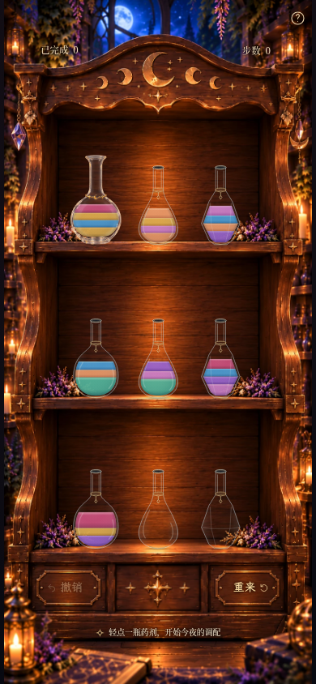 |

[360×640 旧版](milestone3d-360x640-legacy.png) · [360×640 新版](milestone3d-360x640-polished.png) · [320×568 新版](milestone3d-320x568.png)。
短屏继续使用现有纵向滚动策略。

## 各液量同条件局部

高清局部为相同手机视口的 **DPR4 真实浏览器裁剪**；每组也提供完整游戏页面。

### 空瓶

[旧版完整页](milestone3d-empty-legacy-390x844.png) · [新版完整页](milestone3d-empty-polished-390x844.png)

| 旧版局部 | 新版局部 |
| --- | --- |
| 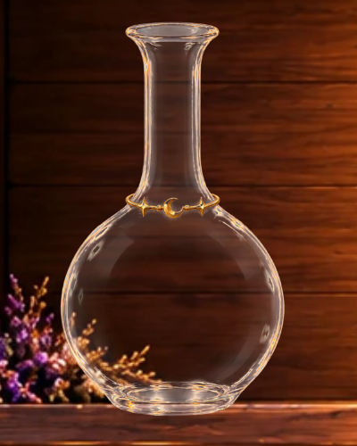 |  |

### 1 单位紫色

[旧版完整页](milestone3d-purple-legacy-390x844.png) · [新版完整页](milestone3d-purple-polished-390x844.png)

| 旧版局部 | 新版局部 |
| --- | --- |
| 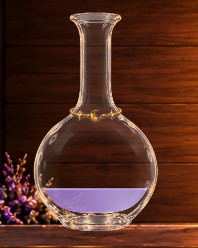 | 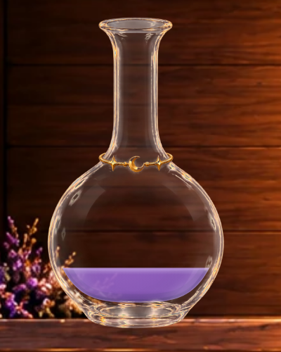 |

### 1 单位蓝色

[旧版完整页](milestone3d-blue-legacy-390x844.png) · [新版完整页](milestone3d-blue-polished-390x844.png)

| 旧版局部 | 新版局部 |
| --- | --- |
| 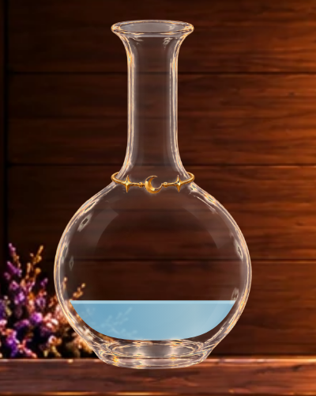 | 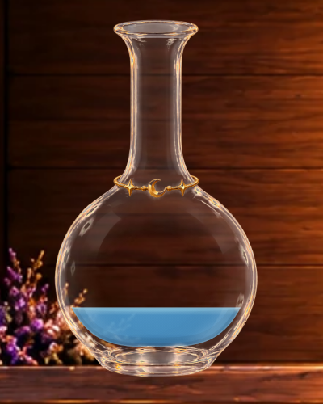 |

### 1 单位蜂蜜金

[旧版完整页](milestone3d-gold-legacy-390x844.png) · [新版完整页](milestone3d-gold-polished-390x844.png)

| 旧版局部 | 新版局部 |
| --- | --- |
| 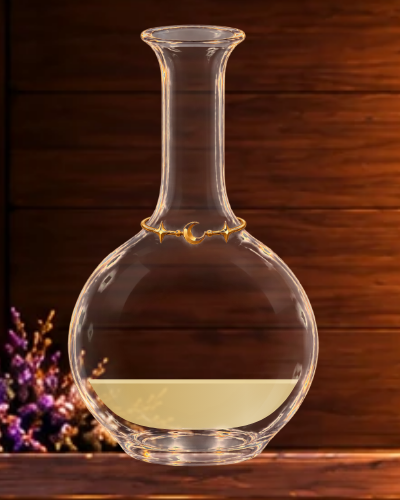 |  |

### 2 层：金 / 兰花粉

[旧版完整页](milestone3d-two-colors-legacy-390x844.png) · [新版完整页](milestone3d-two-colors-polished-390x844.png)

| 旧版局部 | 新版局部 |
| --- | --- |
| 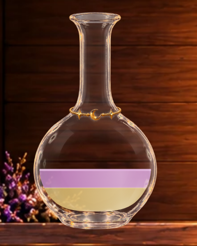 | 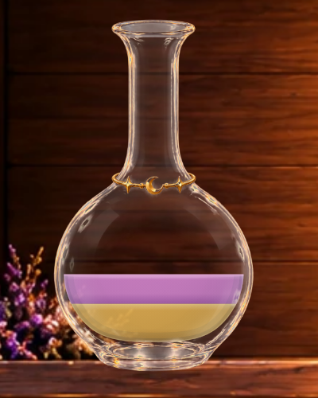 |

### 4 层混色：金 / 蓝 / 金 / 玫瑰

[旧版完整页](milestone3d-four-layers-legacy-390x844.png) · [新版完整页](milestone3d-four-layers-polished-390x844.png)

| 旧版局部 | 新版局部 |
| --- | --- |
| 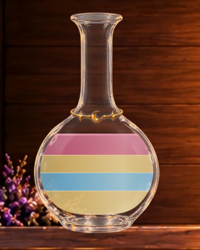 | 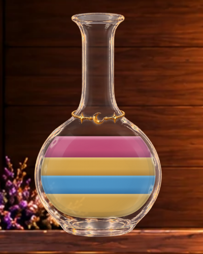 |

所有状态都来自现有可验证的谜题与合法解法历史：moon-1 第5/11/4/1步为空瓶/紫色/金色/双色，
moon-4 第4步为蓝色，moon-2 初始为四层相邻混色（金重复一次，非四种互不重复颜色）。
没有改预设、注入无效存档或添加新关卡。

## 同色满瓶检查

真实完成 moon-1 的34步解法并关闭结算后：

| 旧版 | 新版 |
| --- | --- |
| 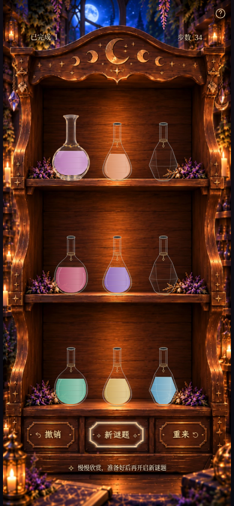 |  |

连续同色单位在新版中共用一段渐变，避免人为画出四条暗纹；四格容量和游戏棋盘完全不变。
这组截图使用减少动态效果，保证翻板及星尘不干扰材质比较。

## 实际倒药

[MP4](milestone3d-pour.mp4) · [GIF](milestone3d-pour.gif)

139 个真实浏览器 screencast 帧，采样跨度 **3.933秒**；编码 MP4 为 **390×844 / 30fps / 4.17秒**（含结尾停留）。
正常游戏时钟下，依次真实触摸 index0→7、index6→0，展示正式瓶作为来源与接收、液量变化和回位。

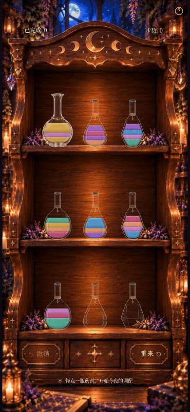

[来源完整页](milestone3d-pour-0.png) · [接收完整页](milestone3d-pour-1.png) ·
[来源局部](milestone3d-source-detail.png) · [接收局部](milestone3d-receiver-detail.png)。
固定视口关键帧：[选中](milestone3d-selected.png) → [120ms](milestone3d-flight-120ms.png) →
[320ms](milestone3d-flight-320ms.png) → [540ms](milestone3d-flight-540ms.png) →
[790ms](milestone3d-flight-790ms.png) → [回位](milestone3d-flight-1040ms.png)。
视频用真实时钟；单帧用浏览器时钟定位，没有静态拼接冒充动画。

## 本轮改变

- 七种颜色维持原有 ID、名称与色相身份，提高纯度，尤其增强蓝、紫与蜂蜜金。
- 每段颜色有沿重力方向的浅顶、主体和较深底部渐变，填充透明度从0.92微调到0.93。
- 在真实瓶腔轮廓处加低透明度厚度阴影与窄透光边；效果限制在实际液体区域内，不画在干燥玻璃上。
- 顶面仍是原有水平容量平面；只在其下方绘制约1 SVG单位深的柔和弯月高光。
  高光宽度依据当前瓶腔与液面交点计算，倾斜时也沿水平液面。
- 层间细亮边从0.8宽/0.8透明度收敛到0.5宽/0.36透明度，保留颜色分层并减少硬线感。
- 相邻同色单位只合并视觉渐变；不同颜色边界及真实液量不合并。

| 颜色 | 旧主体色 | 新主体色 |
| --- | --- | --- |
| 玫瑰红 | #c25b79 | #c94f7b |
| 紫水晶 | #9774c4 | #9963cd |
| 薄荷绿 | #68b99e | #50b59b |
| 天空蓝 | #6eafd0 | #4b9cd3 |
| 蜂蜜金 | #d6b56b | #dfac4d |
| 珊瑚橙 | #df986f | #e89868 |
| 兰花粉 | #ca8bc7 | #cd7fc8 |

实现只用轻量 SVG 渐变、路径和裁剪，无动画库、模糊滤镜、新粒子、强发光或额外 React 定时更新。
玻璃仍在液体前景；液体仍是独立动态层，未烘焙进 PNG/WebP。

## 保留与验证

木柜、HUD（包括3C的1px光学校正）、按钮、帮助、字体、玻璃素材、瓶型、13%尺寸和柜内坐标均未改动。
原有瓶腔面积、四格规则、重力液面、真实瓶口、640ms提交、920ms总时长、撤销/重来/新谜题、结算与奖励存档机制均保留。
液流与接收流只自然使用当前所选的全局配色，轨迹与机制不变。

实测截图对比：`legacy` 完整页面与3C基准对应截图像素一致；空瓶局部与HUD区域的新旧像素也完全一致。
新增小量浏览器回归，验证完整有效v3存档（含累计7、晶石13）、棋盘历史、几何与HUD在参数切换后保持一致；
并检查来源/接收模式、水平边界、瓶口连接、撤销/刷新及减少动态效果。

验证结果：**85 项单元测试、102 项 Playwright 浏览器测试全部通过；生产构建及 `git diff --check` 通过**。

## 当前限制

这是有体积提示的二维风格化液体，仍需明确显示水平色层，不能等同真实三维透明体或物理折射。
每层的渐变会随实际剩余液量压缩；极薄的倒出末段主要依靠颜色与流线辨认。
强玻璃反光仍可能略微提亮局部颜色。实体 iOS/Safari 与低端手机 GPU 尚未验证。
本轮仅供视觉选择；可通过参数回到旧版，不继续开发特殊药剂或其他阶段。
