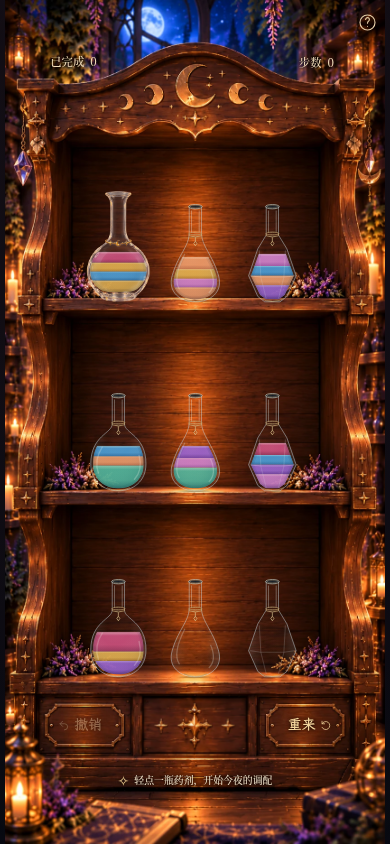
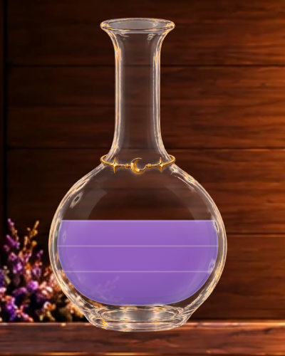
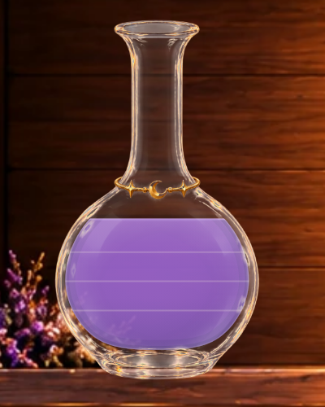
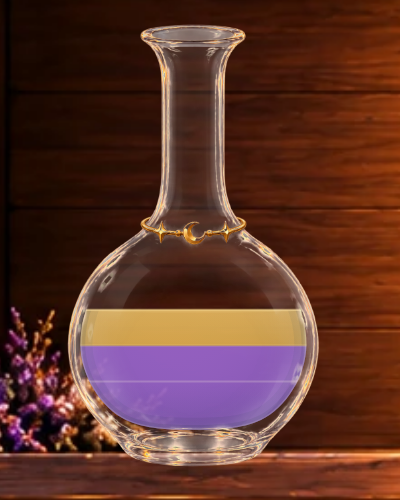
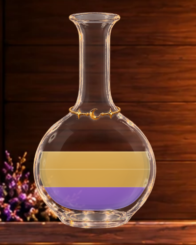
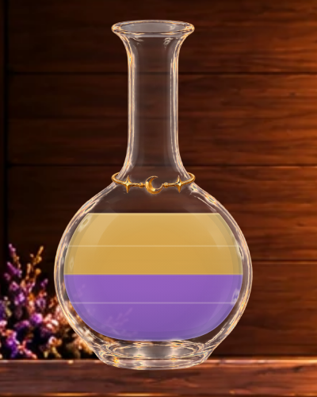
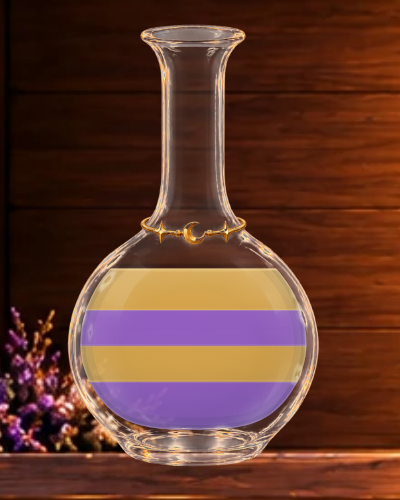
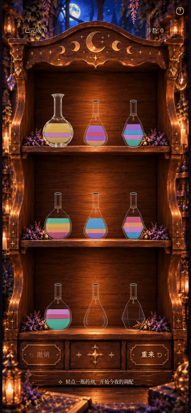

# Milestone 3E · 统一光照与三级边界验收

默认 / `?liquid=unified`：本轮方案。`?liquid=polished` 完整保留3D，`?liquid=legacy` 保留3C药液。
参数重载生效，不写存档，没有玩家设置入口；玻璃继续使用3C星—珠—月—珠—星素材。

## 实际游戏：390×844 同状态对照

以下是**生产构建、真实可玩的 moon-2 初始局面、DPR1、同样2200ms时刻**。

| 3D polished | 3E unified |
| --- | --- |
|  |  |

[legacy完整页](milestone3e-game-legacy-390x844.png) ·
[360×640 polished](milestone3e-game-polished-360x640.png) · [360×640 unified](milestone3e-game-unified-360x640.png) ·
[320×568 unified](milestone3e-game-unified-320x568.png)。短屏沿用原有纵向滚动。

两种旧模式的完整截图分别与3D基准对应图片**逐像素一致**；新旧HUD区域也逐像素一致。

## 组件夹具：正常手机页面 + 高清局部

以下12组是**只读视觉夹具，不是可玩谜题或存档**。在真实木柜页面里，用实际 `BottleArt` 组件替换 index0 的显示；
其他八瓶仍是同页原型。原游戏棋盘、撤销历史、奖励与 localStorage 没有被改写，每次截图前后均检查存档字符串相同。

主页面用生产构建；夹具通过 Vite 开发服务器加载 `tests/fixtures/liquidPreview.tsx`，渲染同一份组件源码。
无截图合成、无无效存档、无新增预设；夹具不进入正式构建。页面临时设为 `inert` 禁止交互，重载即可退出。
[夹具数组清单](milestone3e-fixtures.json)。A=紫水晶、B=蜂蜜金；数组从瓶底到瓶顶。

每项都提供 **390×844完整页面** 和同视口的 **DPR4浏览器局部裁剪**。最终判断请同时打开手机完整页，勿只看放大图。

### 同色连续单位

#### 1单位紫色

[手机完整页：3D](milestone3e-fixture-purple-1-polished-390x844.png) · [手机完整页：3E](milestone3e-fixture-purple-1-unified-390x844.png)

| 3D | 3E |
| --- | --- |
|  |  |

#### 2单位紫色

[手机完整页：3D](milestone3e-fixture-purple-2-polished-390x844.png) · [手机完整页：3E](milestone3e-fixture-purple-2-unified-390x844.png)

| 3D | 3E |
| --- | --- |
|  |  |

#### 3单位紫色

[手机完整页：3D](milestone3e-fixture-purple-3-polished-390x844.png) · [手机完整页：3E](milestone3e-fixture-purple-3-unified-390x844.png)

| 3D | 3E |
| --- | --- |
|  |  |

#### 4单位紫色

[手机完整页：3D](milestone3e-fixture-purple-4-polished-390x844.png) · [手机完整页：3E](milestone3e-fixture-purple-4-unified-390x844.png)

| 3D | 3E |
| --- | --- |
|  |  |

### 不同颜色接触

#### 紫 / 蓝

[手机完整页：3D](milestone3e-fixture-different-2-polished-390x844.png) · [手机完整页：3E](milestone3e-fixture-different-2-unified-390x844.png)

| 3D | 3E |
| --- | --- |
|  |  |

#### 紫 / 蓝 / 金

[手机完整页：3D](milestone3e-fixture-different-3-polished-390x844.png) · [手机完整页：3E](milestone3e-fixture-different-3-unified-390x844.png)

| 3D | 3E |
| --- | --- |
|  |  |

#### 紫 / 蓝 / 金 / 玫瑰

[手机完整页：3D](milestone3e-fixture-different-4-polished-390x844.png) · [手机完整页：3E](milestone3e-fixture-different-4-unified-390x844.png)

| 3D | 3E |
| --- | --- |
|  |  |

### 同色与异色混排

#### A / A / B

[手机完整页：3D](milestone3e-fixture-AAB-polished-390x844.png) · [手机完整页：3E](milestone3e-fixture-AAB-unified-390x844.png)

| 3D | 3E |
| --- | --- |
|  |  |

#### A / B / B

[手机完整页：3D](milestone3e-fixture-ABB-polished-390x844.png) · [手机完整页：3E](milestone3e-fixture-ABB-unified-390x844.png)

| 3D | 3E |
| --- | --- |
|  |  |

#### A / A / B / B

[手机完整页：3D](milestone3e-fixture-AABB-polished-390x844.png) · [手机完整页：3E](milestone3e-fixture-AABB-unified-390x844.png)

| 3D | 3E |
| --- | --- |
|  |  |

#### A / B / A / B

[手机完整页：3D](milestone3e-fixture-ABAB-polished-390x844.png) · [手机完整页：3E](milestone3e-fixture-ABAB-unified-390x844.png)

| 3D | 3E |
| --- | --- |
|  |  |

### 空瓶

[手机完整页：3D](milestone3e-fixture-empty-polished-390x844.png) · [手机完整页：3E](milestone3e-fixture-empty-unified-390x844.png)

| 3D | 3E |
| --- | --- |
|  |  |

复现夹具：在 `npm run dev` 页面控制台加载
`const {renderLiquidFixture}=await import('/tests/fixtures/liquidPreview.tsx')`，
再调用如 `renderLiquidFixture([1,1,4])`。只用于开发截图，页面不允许继续操作这份显示夹具。

## 实际四次倒药录像

[MP4](milestone3e-pour.mp4) · [GIF](milestone3e-pour.gif)

**277个真实screencast帧，采样跨度8.004秒，MP4为390×844 /30fps /8.23秒（含结尾停留）**。
从正常合法谜题开始，实际触摸执行：

1. index0→7：从多色瓶连续倒出两单位蜂蜜金。
2. index6→0：正式瓶接收兰花粉。
3. index0→8：再连续倒出两单位兰花粉，展示新的顶部颜色接替。
4. index7→0：向已有一单位金的正式瓶倒入两单位金，单位提示随液量上升。

末态为真实4步、index0三单位金，浏览器同时校验该棋盘结果。
[相同合法末态的完整截图](milestone3e-live-three-gold.png)（该单张使用减少动态效果；录像按正常时钟）。

[来源完整页](milestone3e-pour-0.png) · [接收完整页](milestone3e-pour-1.png) ·
[来源局部](milestone3e-source-detail.png) · [接收局部](milestone3e-receiver-detail.png) ·
[选中](milestone3e-selected.png) → [320ms](milestone3e-flight-320ms.png) →
[540ms](milestone3e-flight-540ms.png) → [回位1040ms](milestone3e-flight-1040ms.png)。
视频来自正常浏览器时钟，无静态图拼接；单独关键帧用固定视口/浏览器时钟定位。

## 三级边界和统一光照实现

- **颜色层**只填3D原有主体色（0.93透明度），连续同色单位共享一段实色。颜色本身不再重启纵向渐变。
- **整体光照**跨所有颜色连续绘制一次：按当前液体整体的顶/底平面设置纵向光照，再叠加克制的瓶壁体积明暗。
  瓶壁光照随玻璃旋转；外部裁剪平面和所有边界反向补偿瓶身角度，保持世界坐标水平。
- **Level1自由液面**只在最顶方绘制一次：0.65 SVG宽、0.58透明度的窄亮边，加小于1 SVG深的弯月高光。
  宽度由真实瓶腔与水平面的交点决定；空瓶不绘制。
- **Level2异色接触**在准确单位平面上画一条0.55 SVG宽、0.34透明度的轻亮边；主要区分仍来自两侧色差。
  没有该层自己的顶亮/底暗，也没有双线夹层。
- **Level3同色单位**使用同样0.55 SVG宽、较低0.22透明度的暖白细提示，不改变两侧主体色。
  手机中有轻微可读性，高清局部更清楚；不是粗黑横杠或两套明暗描边。
- 接近自由液面的内部提示在约1.5 SVG间距内渐隐/渐现，避免新单位刚倒入或倒尽时突然跳出重叠亮线。

所有光照、接口和弯月都被限制在瓶腔及实际液体占据区，不照亮干玻璃；仍使用同一套 `liquidSurfaces` 面积/重力计算。
这避免了3D各色段独立打光引起的夹心反差，而不是把色层模糊混在一起。

## 范围、验证与限制

运行代码只新增 `UnifiedLiquid.tsx`，在 `Bottle.tsx` 接入分支，`liquidAppearance.ts` 增加统一版选择。
`PolishedLiquid.tsx`、旧配色值、玻璃PNG/WebP、瓶腔/瓶口、13%尺寸、640ms提交/920ms动画、HUD与1px校正、木柜、按钮、
帮助、字体、结算和 `src/game/` 都没有修改。没有粒子、模糊、额外动画循环、强发光或新依赖。

三种模式的存档/布局/空瓶、边界类型与强度、来源/接收、水平面/瓶口、撤销/刷新和减少动态效果均有针对性回归。
验证结果：**85项单元测试、104项Playwright浏览器测试全部通过；生产构建及 `git diff --check` 通过**。

限制：仍是二维着色，不模拟物理折射；同色提示是辅助刻度，不是实际互不相融的液面。
极薄的流动末段提示会弱化，反光也可能在局部影响可见度；不同数字设备的像素密度会改变细线观感。
整体仍保留解谜需要的水平色块，视觉自然度请结合完整手机图和录像验收。实体Safari/iOS及低端GPU尚未验证。
