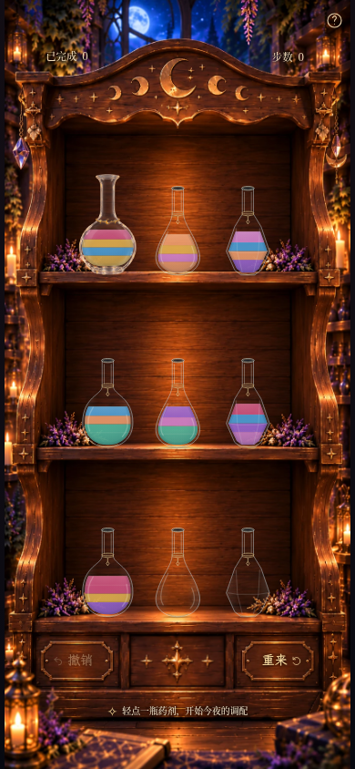
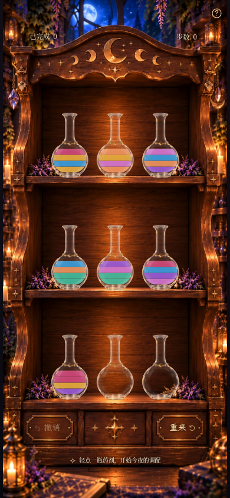
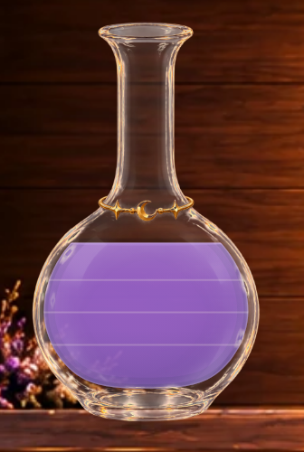
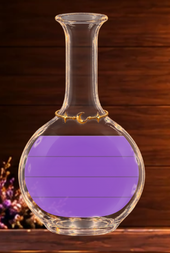
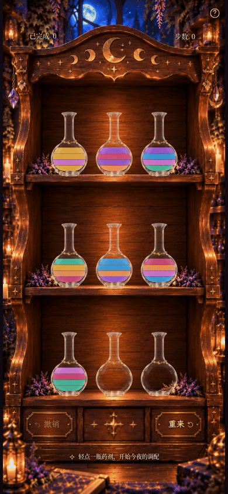

# Milestone 3F · 九瓶统一与等高药液验收

本轮默认 / `?liquid=clean`：九只相同暖金星月玻璃瓶、严格等高单位、统一暗灰细缝及简化药液材质。
复用既有星—珠—月—珠—星素材，没有生成或重绘图片。木柜、HUD、按钮及游戏系统未改。

## 真实游戏：同视口、同棋盘对照

以下来自**生产构建、可玩的 moon-2 初始局面、390×844 / DPR1、同样2200ms时刻**。
3E回退图与上一轮提交的 `milestone3e-game-unified-390x844.png` **逐像素一致**；新版HUD区域也与旧版逐像素一致。

| Milestone 3E：一只正式瓶、八只原型 | Milestone 3F：九只正式瓶、clean药液 |
| --- | --- |
|  |  |

另有[九只正式瓶 + 旧unified药液](milestone3f-game-uniform-unified-390x844.png)，可单独比较等高模型与材质，减少瓶型差异干扰。

[390×844新版原图](milestone3f-game-clean-390x844.png) ·
[360×640](milestone3f-game-clean-360x640.png) ·
[320×568视口](milestone3f-game-clean-320x568.png) ·
[桌面1280×900](milestone3f-game-clean-1280x900.png) ·
[实际34步完成局面、七色满瓶](milestone3f-completed-390x844.png)

390×844与360×640完整显示木柜及底部按钮。320×568继续采用原有短屏纵向滚动，截图是固定视口，不伪装成完整长页面。
所有瓶子统一保持已验收的1.13×比例、原水平中心和木板落点；可见瓶腹之间留有间距，无需另改柜体布局。

## 只读液量与排列夹具

下表是**实际浏览器渲染的只读组件夹具，不是可玩谜题或新存档**。
在真实木柜页面内用现有 `tests/fixtures/liquidPreview.tsx` 渲染真实 `BottleArt`，只替换index0显示；其余八瓶也是本轮正式瓶。
夹具页面临时 `inert`，重载退出。每次捕获均检查localStorage字符串前后相同，没有制造无效棋盘或改写奖励。

主游戏图与录像使用生产构建4192；夹具使用Vite开发服务器4191加载同一份组件源码，测试模块不进入正式构建。
每项包含390×844手机完整页和同视口DPR4浏览器局部裁剪，未做图片合成。
A=紫水晶、B=蜂蜜金；数组从瓶底到瓶顶。[数组清单](milestone3f-fixtures.json)。

| 状态 | 手机完整页 | 高清局部 |
| --- | --- | --- |
| 空瓶 | [完整页](milestone3f-fixture-empty-390x844.png) | [局部](milestone3f-fixture-empty-detail.png) |
| 1单位紫色 | [完整页](milestone3f-fixture-purple-1-390x844.png) | [局部](milestone3f-fixture-purple-1-detail.png) |
| 2单位紫色 | [完整页](milestone3f-fixture-purple-2-390x844.png) | [局部](milestone3f-fixture-purple-2-detail.png) |
| 3单位紫色 | [完整页](milestone3f-fixture-purple-3-390x844.png) | [局部](milestone3f-fixture-purple-3-detail.png) |
| 4单位紫色 | [完整页](milestone3f-fixture-purple-4-390x844.png) | [局部](milestone3f-fixture-purple-4-detail.png) |
| 紫 / 蓝 | [完整页](milestone3f-fixture-different-2-390x844.png) | [局部](milestone3f-fixture-different-2-detail.png) |
| 紫 / 蓝 / 金 | [完整页](milestone3f-fixture-different-3-390x844.png) | [局部](milestone3f-fixture-different-3-detail.png) |
| 紫 / 蓝 / 金 / 玫瑰 | [完整页](milestone3f-fixture-different-4-390x844.png) | [局部](milestone3f-fixture-different-4-detail.png) |
| A / A / B | [完整页](milestone3f-fixture-AAB-390x844.png) | [局部](milestone3f-fixture-AAB-detail.png) |
| A / B / B | [完整页](milestone3f-fixture-ABB-390x844.png) | [局部](milestone3f-fixture-ABB-detail.png) |
| A / A / B / B | [完整页](milestone3f-fixture-AABB-390x844.png) | [局部](milestone3f-fixture-AABB-detail.png) |
| A / B / A / B | [完整页](milestone3f-fixture-ABAB-390x844.png) | [局部](milestone3f-fixture-ABAB-detail.png) |

### 同色满瓶：3E与3F

相同玻璃、尺寸、紫色四单位、背景和局部范围；仅切换药液版本。

| 3E等面积、三级边界与整体纵向明暗 | 3F等高、统一暗灰细缝与简化明暗 |
| --- | --- |
|  |  |

## 等高测量与倾斜模型

正式瓶的有效液体范围从瓶腔底到既有满液线，仍在金饰下方保留空瓶肩。
静置累积单位数u的参考高度为：`y(u) = floor − (floor − full) × u / 4`。
所以每单位固定高度；小数u也按相同高度连续变化。

390×844浏览器测得满瓶的四个高度分别为：

| 自下而上 | CSS px |
| --- | --- |
| 第1格 | 10.048932 |
| 第2格 | 10.048937 |
| 第3格 | 10.048930 |
| 第4格 | 10.048937 |

差异小于0.00001px，来自SVG DOM浮点数序列化。1/2/3单位时的高度与这些单位一致。
三道细缝对应CSS y≈282.73047、272.68152、262.63260；与液层边界重合。
[完整DOM测量JSON](milestone3f-height-measurements.json) · [浏览器辅助线图](milestone3f-equal-height-guide.png)

青色虚线0–4仅由捕获脚本临时插入浏览器，不存在于正式游戏代码。
单元测试检查精确等高、分数单位及接近直立时的连续性；浏览器测试检查1–4单位、内部细缝数量/位置、增减高度和存档不变。

倾斜时先求该累积单位数对应的**直立参考面积** `A(u) = area(cavity below y(u))`，
再沿用现有多边形求解器，在旋转后的瓶腔内求水平面，使其下方面积等于A(u)。
实际瓶沿的倾斜角计算也使用同一个A(u)，防止液面与瓶口脱节。
液层和细缝反向补偿瓶身角度，保持世界坐标水平；回正时连续恢复等高位置。

这是风格化的视觉单位模型：逻辑四单位不变，**不声称每单位具有相同物理二维体积**。
接收、排出和连续同色转移仍由现有事务的分数液量驱动，未改动画提交或游戏规则。

## 材质、细缝与颜色

- 主体每单位填相应宝石色，透明度.94，不再为每层重启上下明暗渐变。
- 只有一次很弱的横向瓶壁明暗：边缘暖灰褐最大.05，中间接近透明；玻璃前景仍提供主要反光。
  无蓝灰底部阴影、厚壁描边或叠加的纵向体积场。
- 每道内部细缝一律使用同一灰褐色 `#544d47`，宽1.2 SVG单位（390×844下约1.04 CSS px）；
  沿厚度方向透明度0→.07→.38→.07→0，渐变柔化而非硬边；没有挖空的透明带，没有白色/金色边界。
- 同色和异色完全相同；一单位0道、二单位1道、三单位2道、四单位3道，空瓶无液体效果。
  刚出现/将消失的薄层边界渐隐，避免重叠；随液层运动，不固定在玻璃上。
- 最上方自由面只保留一条.65 SVG单位、.48透明度的柔和同色高光；不额外画弯月厚边。
- 没有液体粒子、发光、闪片、模糊滤镜或新动画循环。

| 药液 | 3E主体色 | 3F主体色 |
| --- | --- | --- |
| 玫瑰红 | `#c94f7b` | `#ce4778` |
| 紫水晶 | `#9963cd` | `#9858d2` |
| 薄荷绿 | `#50b59b` | `#43b99b` |
| 天空蓝 | `#4b9cd3` | `#399bd9` |
| 蜂蜜金 | `#dfac4d` | `#e3a83d` |
| 珊瑚橙 | `#e89868` | `#eb915c` |
| 兰花粉 | `#cd7fc8` | `#d174cd` |

颜色ID、中文名和游戏含义不变；源液、接收瓶和液流使用同一活动配色。无荧光或独立自发光处理。

## 实际浏览器倒药

[MP4（390×844，8.367秒）](milestone3f-pour.mp4) · [GIF（8.35秒）](milestone3f-pour.gif)

278个真实Chromium screencast帧、采样跨度8.130秒，按正常浏览器时钟执行四次合法触摸操作：

1. index0→7：多色来源瓶连续倒出两单位蜂蜜金。
2. index6→0：正式瓶接收兰花粉。
3. index0→8：连续倒出两单位兰花粉。
4. index7→0：向已有一单位金的正式瓶倒入两单位金。

末态由浏览器核验：真实4步、index0三单位金。录像无静态设计图拼接、无修改动画时序；编码包含结尾停留。

[来源完整页](milestone3f-pour-0.png) · [接收完整页](milestone3f-pour-1.png) ·
[来源局部](milestone3f-source-detail.png) · [接收局部](milestone3f-receiver-detail.png) ·
[选中](milestone3f-selected.png) → [120ms](milestone3f-flight-120ms.png) →
[320ms](milestone3f-flight-320ms.png) → [540ms](milestone3f-flight-540ms.png) →
[790ms](milestone3f-flight-790ms.png) → [回位1040ms](milestone3f-flight-1040ms.png)。
单张关键帧由固定视口及浏览器时钟定位，视频按正常时钟录制。

## 回退与实现文件

| 内部参数 | 用途 |
| --- | --- |
| 默认 / `?liquid=clean` | 本轮等高/细缝/新配色 |
| `?liquid=unified` | 原3E材质与等面积模型；默认仍是九只正式瓶 |
| `?liquid=polished` | 原3D材质/配色/等面积模型 |
| `?liquid=legacy` | 原3C材质/配色/等面积模型 |
| `?bottles=sample&liquid=unified` | 完整3E的一只正式瓶+八只原型对照 |
| `?glass=candle` / `?glass=original` | 保留3B暖光/原版玻璃及匹配瓶腔 |

参数重载生效，不写存档，没有玩家UI切换按钮。所有旧图及原始参考均保留。

实际运行代码修改：新增 `src/components/CleanLiquid.tsx`、`src/scene/bottlePresentation.ts`；
接入 `Bottle.tsx`、`bottleGeometry.ts`、`cabinetLayout.ts`、`liquidAppearance.ts`。
旧 `UnifiedLiquid.tsx` / `PolishedLiquid.tsx` 未改。测试仅更新受影响断言并补充必要几何/细缝回归。

`App.tsx`、`styles.css`、`PourAnimation.tsx`、全部 `src/game/`、HUD锚点/1px校正、木柜和玻璃图片、
按钮/星尘、帮助、羊皮纸、字体均未改。**640ms提交 /920ms动画**、输入锁、撤销、重来、新谜题、完成次数、晶石和存档保持原机制。

## 验证与限制

**86项单元测试、106项Playwright测试全部通过；生产构建及 `git diff --check` 通过。**
覆盖桌面与手机触摸、来源/接收/水平面/瓶口/回位、快速输入与中断、完整解法、存档恢复、旧版本选择、
奖励/结算、字体/键盘/减少动态效果、木板和响应式布局。所有截图和录像页面无浏览器错误。

限制：仍是二维插画与风格化参考面积模型，不模拟物理折射或单位等体积；细缝在不同DPR屏幕的可见度会有差异。
原素材边缘反光仍可能提亮药液；金饰在手机实际尺寸下仅数个像素。实体Safari/iOS与低端GPU尚未验证。
本轮到此停止，等待视觉验收；未制作不同正式瓶型、特殊药剂、新机制或公开部署。
