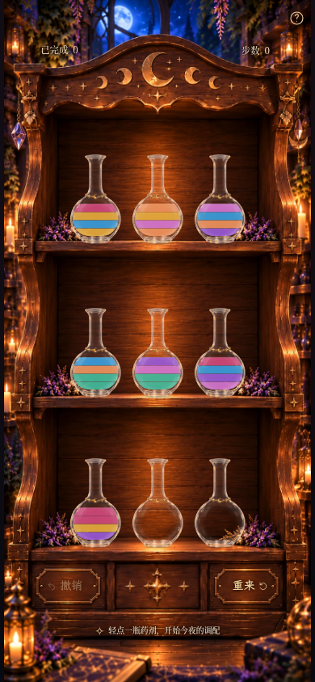
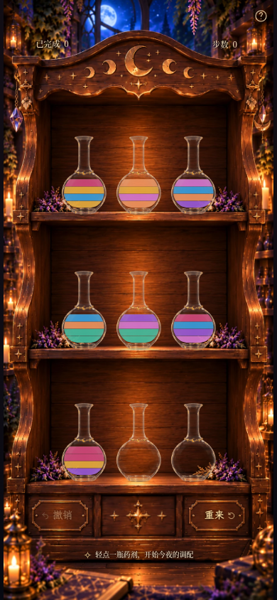
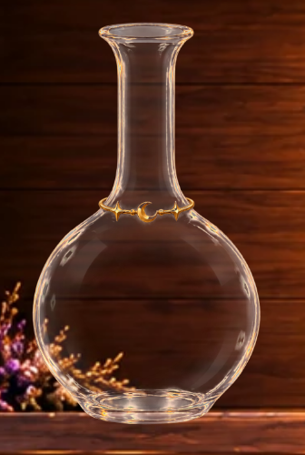
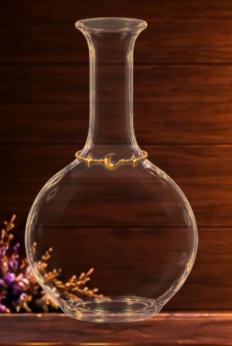
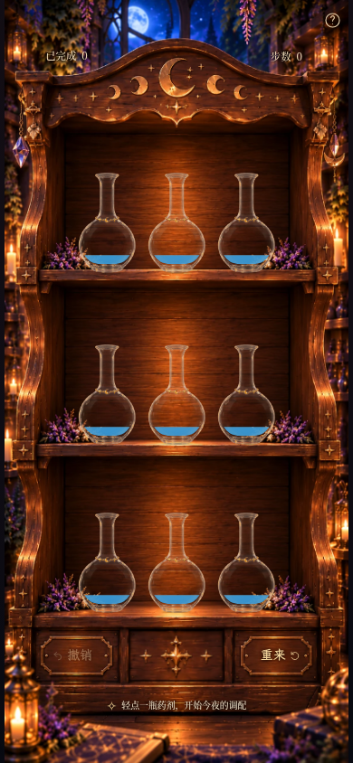
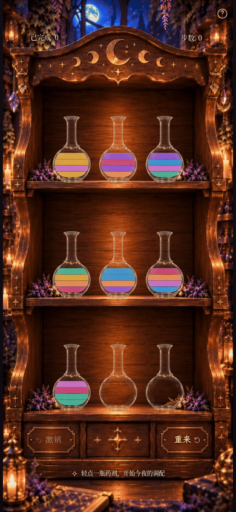

# Milestone 3G · 柔和玻璃与动态环境受光验收

本轮先处理玻璃素材的银白反光，再叠加位置相关的二维环境光。
**主要改善来自高光柔化；ambient相对soft是细微的暖冷受光补充。** 保留三版供判断，没有把细微差异当作真实三维折射。

## 同状态九瓶全景

真实生产构建、可玩的moon-2初始局面、相同390×844 / DPR1、相同2200ms捕获时刻。
`flat`与3F提交的完整页面**逐像素一致**。ambient的HUD区域也与3F逐像素一致。

| 3F原版 · flat | 仅柔化高光 · soft | 柔化 + 环境光 · ambient（默认） |
| --- | --- | --- |
|  |  |  |

完整原图：[flat 390×844](milestone3g-game-flat-390x844.png) ·
[soft 390×844](milestone3g-game-soft-390x844.png) ·
[ambient 390×844](milestone3g-game-ambient-390x844.png)

同样状态的360×640对照：[flat](milestone3g-game-flat-360x640.png) ·
[soft](milestone3g-game-soft-360x640.png) · [ambient](milestone3g-game-ambient-360x640.png)。
另有[320×568视口](milestone3g-game-ambient-320x568.png)和[1280×900桌面](milestone3g-game-ambient-1280x900.png)。
短屏继续使用既有纵向滚动；没有修改柜体比例、瓶子尺寸、位置或HUD。

全景中重点比较瓶口/瓶颈的白管感、两侧大片白反射、底部亮环与木柜的关系。
soft和ambient的瓶底较收敛，瓶腹更清透，金饰保持原设计；两版之间不追求夸张的变色差异。

## 空瓶与液量局部对照

以下是实际浏览器的DPR4局部截图，仍处于相同390×844木柜页面。
使用既有开发只读夹具渲染真实 `BottleArt`，不是静态瓶子合成图，也不是新谜题。
夹具只改变显示，存档字符串前后相同，页面设为 `inert`；重载退出。
生产完整页与录像使用4192，夹具由Vite4191加载同一份源码，测试模块不进入正式构建。

### 空瓶：木纹、瓶颈与瓶底

| flat | soft | ambient |
| --- | --- | --- |
|  |  |  |

### 其他要求状态

| 状态（底→顶） | flat局部 | soft局部 | ambient局部 | ambient手机完整页 |
| --- | --- | --- | --- | --- |
| 空瓶 | [查看](milestone3g-empty-flat-detail.png) | [查看](milestone3g-empty-soft-detail.png) | [查看](milestone3g-empty-ambient-detail.png) | [完整页](milestone3g-fixture-empty-390x844.png) |
| 一单位蓝色 | [查看](milestone3g-blue-1-flat-detail.png) | [查看](milestone3g-blue-1-soft-detail.png) | [查看](milestone3g-blue-1-ambient-detail.png) | [完整页](milestone3g-fixture-blue-1-390x844.png) |
| 一单位紫色 | [查看](milestone3g-purple-1-flat-detail.png) | [查看](milestone3g-purple-1-soft-detail.png) | [查看](milestone3g-purple-1-ambient-detail.png) | [完整页](milestone3g-fixture-purple-1-390x844.png) |
| 四单位紫色 | [查看](milestone3g-purple-4-flat-detail.png) | [查看](milestone3g-purple-4-soft-detail.png) | [查看](milestone3g-purple-4-ambient-detail.png) | [完整页](milestone3g-fixture-purple-4-390x844.png) |
| 紫 / 蓝 / 金 / 玫瑰 | [查看](milestone3g-different-4-flat-detail.png) | [查看](milestone3g-different-4-soft-detail.png) | [查看](milestone3g-different-4-ambient-detail.png) | [完整页](milestone3g-fixture-different-4-390x844.png) |

[夹具数组](milestone3g-fixtures.json)。三个版本的液体DOM、几何、透明度与配色完全相同。
截图中的中央底层蓝/紫/金取样像素也一致，变化集中在既有玻璃反光区域；上肩边缘少量叠加变化仍属玻璃。
没有对整瓶SVG或药液套暖色滤镜，分隔细缝不被新增亮线覆盖。

## 相同瓶子、相同液量，不同位置

九个位置均显示同一只正式玻璃瓶和一单位蓝色，只读夹具，不改写真实棋盘或存档：

[flat完整页](milestone3g-positions-flat-390x844.png) ·
[soft完整页](milestone3g-positions-soft-390x844.png) ·
[ambient完整页](milestone3g-positions-ambient-390x844.png)

[上层左/中/右高清局部](milestone3g-positions-upper-detail.png) ·
[下层左/中/右高清局部](milestone3g-positions-lower-detail.png) ·
[实际pose与局部光源坐标JSON](milestone3g-position-measurements.json)。

差异很轻：暖光随与两侧烛光/灯具的距离变化，顶部保留少量月光分量；没有人为把每层设成不同颜色。
不同木纹背景本来就有明暗差异，请结合soft/ambient同位置对照，而非只比较不同架位的最终亮度。

## 实际移动与倒药

[MP4：390×844 /8.20秒](milestone3g-pour.mp4) · [GIF：390×844 /8.20秒](milestone3g-pour.gif)

**277个真实Chromium screencast帧，采样跨度7.961秒**，按正常浏览器时钟执行四次合法触摸倒药：
0→7（连续两单位金）、6→0（接收兰花粉）、0→8（连续两单位兰花粉）、7→0（接收两单位金）。
浏览器核验最后是4步、index0三单位金。编码含结尾停留，没有将静态设计稿拼成动画，也没有改变倒药时间线。

[来源完整页](milestone3g-pour-0.png) · [接收完整页](milestone3g-pour-1.png) ·
[来源局部](milestone3g-source-detail.png) · [接收局部](milestone3g-receiver-detail.png) ·
[选中](milestone3g-selected.png) → [120ms](milestone3g-flight-120ms.png) →
[320ms](milestone3g-flight-320ms.png) → [540ms](milestone3g-flight-540ms.png) →
[790ms](milestone3g-flight-790ms.png) → [回位1040ms](milestone3g-flight-1040ms.png)。
单张关键帧用固定视口和浏览器时钟定位；视频按实际时钟录制。

动态核对未见明显高光闪烁、材质错位或新颜色跳变，瓶口/液流仍相接，液面保持水平。
细小原图反射仍随玻璃转动；新增环境色场相对柜体固定，并非真正的法线/折射渲染。

## 实现与回退

- 新素材通过可复现脚本压缩亮中性反射，保护完整星—珠—月—珠—星金饰区；旧PNG/WebP保留。
  预乘Alpha亮度能量在瓶口/瓶颈/瓶腹侧缘/瓶底分别约下降28%/34%/40%/39%，中央透明区无新增Alpha。
- 六个柔和径向光源以841×1870柜体坐标定义，对应原插画的两侧烛焰、右下灯具和顶部月亮；另有很弱暖棕环境反射。
- 每个光源通过当前瓶子的平移、缩放、绕瓶口旋转的逆变换投回SVG；来源和接收使用同一套换算。
  飞行直接复用既有每帧pose，静置没有新的计时器/RAF/React更新循环。
- 选中180ms CSS上浮用其5px终点作极小受光近似；实际飞行按实时pose更新。
- 环境色场仅通过玻璃响应遮罩叠加，不覆盖透明瓶腹中央或金饰。无新模糊滤镜、大型依赖或光粒。

[素材、处理脚本、光源位置与坐标推导](../../assets/glass-lighting.md)。

| URL内部参数 | 作用 |
| --- | --- |
| `?lighting=flat` | 精确3F玻璃 |
| `?lighting=soft` | 只柔化高光 |
| 默认 / `?lighting=ambient` | 柔化后加入位置相关受光 |

与已有 `?liquid=clean/legacy/polished/unified`、`?bottles=sample` 兼容。
`?glass=candle/original` 继续走原历史玻璃实现，不套用3G。选择不进入玩家UI或存档。

运行代码涉及 `StarMoonGlass.tsx`、`MoonGlass.tsx`、`Bottle.tsx`、`PourAnimation.tsx` 和新增 `scene/glassLighting.ts`。
新素材/脚本另存；测试只增加必要的投影/模式/静置/动态回归，扩展原只读夹具以查看不同瓶位。
药液组件、七色、等高/细缝/容量/瓶口计算、九瓶尺寸/坐标、背景、HUD/帮助/按钮/结算、字体及 `src/game/` 未改。
**640ms提交、920ms总时序、输入锁和减少动态效果均保留。**

## 验证与限制

**88项单元测试、110项Playwright测试全部通过；生产构建与 `git diff --check` 通过。**
覆盖三种模式与旧参数共存、存档/液体DOM不变、静置10秒无漂移，
选择/飞行/倾斜/接收/回位时实际SVG投影到柜体烛焰位置（误差<0.15 CSS px），以及既有规则、完整解法、
撤销/重来/新谜题、奖励/结算、存档恢复、键盘/字体/减少动态效果和响应式布局。
最终截图与录像页面未报告浏览器错误。

这仍是二维材质实验，不模拟物理折射、玻璃法线或背景变形。
soft已经带来主要改善，ambient只提供克制的补充；用户可通过soft判断是否值得保留额外光场。
原始插画中的部分边缘细线仍存在，手机小尺寸下金饰仅数像素。实体Safari/iOS与低端GPU未验证。
本轮停止，等待视觉验收；没有扩展其他瓶型、特殊药剂、玩法或公开部署。
