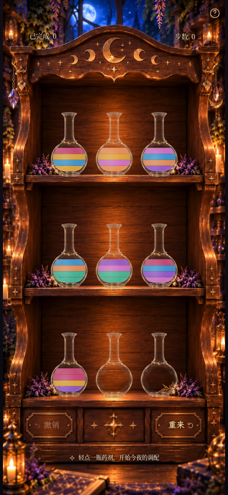
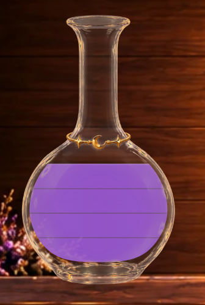
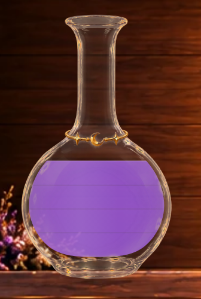
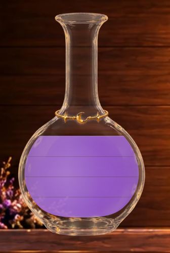

# Milestone 3H · 清透柔光与宝石光泽双方案验收

本轮只改变药液材质与候选版细缝强度，保留3G玻璃、环境光、七色配方、四格等高模型及游戏机制。
默认采用**方案A：清透柔光**；**方案B：宝石光泽**提供更明显的宽柔光泽，原 `clean` 完整保留。
这是基础材质实验，最终美术方向请结合正常手机全景和实际倒药判断。

## 同条件九瓶完整画面

以下来自**真实生产构建、可玩的moon-2初始局面、390×844 / DPR1、相同2200ms时刻**。
三版玻璃均为3G默认ambient。clean完整页与上一轮3G ambient截图逐像素一致，三个版本的HUD区域也一致。

| 原clean | 方案A · soft-translucent（默认） | 方案B · gem-luster |
| --- | --- | --- |
|  |  |  |

390×844原图：[clean](milestone3h-game-clean-390x844.png) · [方案A](milestone3h-game-soft-translucent-390x844.png) · [方案B](milestone3h-game-gem-luster-390x844.png)。

360×640同条件对照：[clean](milestone3h-game-clean-360x640.png) · [方案A](milestone3h-game-soft-translucent-360x640.png) · [方案B](milestone3h-game-gem-luster-360x640.png)。

另有320×568固定视口：[方案A](milestone3h-game-soft-translucent-320x568.png) · [方案B](milestone3h-game-gem-luster-320x568.png)。
短屏继续采用既有纵向滚动策略，瓶子和木柜没有缩放或重新定位。

A的变化较克制，主要是连续的横向透光与更轻的分隔；B在瓶腹加入宽而淡的局部光泽，区别更容易看出。
两者仍保留解谜需要的明确色层，未宣称已经模拟真实透明流体或彻底消除二维色带感。
请重点比较紫色、蓝色和蜂蜜金是否清楚，并观察九瓶同框是否自然，而非只看高倍细节。

## 材质夹具：每种状态的三版全景与高清局部

以下是**浏览器渲染的只读组件夹具**，不是可玩新谜题或存档。
在真实木柜页面中使用现有 `tests/fixtures/liquidPreview.tsx` 渲染实际 `BottleArt`，
仅替换index0的显示，其他八瓶保持同页游戏状态。页面临时 `inert` 禁止操作，重载退出。
每次捕获检查localStorage字符串前后相同，没有改写棋盘、撤销历史或奖励。

完整可玩画面和录像使用生产构建4192；组件夹具通过Vite4191加载同一份源码，测试模块不进入正式构建。
每项均提供**正常390×844完整页面**与同视口的**DPR4实际浏览器局部裁剪**；没有拼接设计图或静态合成药液。

[夹具数组清单](milestone3h-fixtures.json)。下表颜色顺序为瓶底→瓶顶；A=紫水晶、B=蜂蜜金。

| 状态 | clean | 方案A | 方案B |
| --- | --- | --- | --- |
| 空瓶 | [手机完整页](milestone3h-fixture-empty-clean-390x844.png) · [高清局部](milestone3h-fixture-empty-clean-detail.png) | [手机完整页](milestone3h-fixture-empty-soft-translucent-390x844.png) · [高清局部](milestone3h-fixture-empty-soft-translucent-detail.png) | [手机完整页](milestone3h-fixture-empty-gem-luster-390x844.png) · [高清局部](milestone3h-fixture-empty-gem-luster-detail.png) |
| 一单位蓝色 | [手机完整页](milestone3h-fixture-blue-1-clean-390x844.png) · [高清局部](milestone3h-fixture-blue-1-clean-detail.png) | [手机完整页](milestone3h-fixture-blue-1-soft-translucent-390x844.png) · [高清局部](milestone3h-fixture-blue-1-soft-translucent-detail.png) | [手机完整页](milestone3h-fixture-blue-1-gem-luster-390x844.png) · [高清局部](milestone3h-fixture-blue-1-gem-luster-detail.png) |
| 一单位紫色 | [手机完整页](milestone3h-fixture-purple-1-clean-390x844.png) · [高清局部](milestone3h-fixture-purple-1-clean-detail.png) | [手机完整页](milestone3h-fixture-purple-1-soft-translucent-390x844.png) · [高清局部](milestone3h-fixture-purple-1-soft-translucent-detail.png) | [手机完整页](milestone3h-fixture-purple-1-gem-luster-390x844.png) · [高清局部](milestone3h-fixture-purple-1-gem-luster-detail.png) |
| 一单位蜂蜜金 | [手机完整页](milestone3h-fixture-gold-1-clean-390x844.png) · [高清局部](milestone3h-fixture-gold-1-clean-detail.png) | [手机完整页](milestone3h-fixture-gold-1-soft-translucent-390x844.png) · [高清局部](milestone3h-fixture-gold-1-soft-translucent-detail.png) | [手机完整页](milestone3h-fixture-gold-1-gem-luster-390x844.png) · [高清局部](milestone3h-fixture-gold-1-gem-luster-detail.png) |
| 四单位同色紫色 | [手机完整页](milestone3h-fixture-purple-4-clean-390x844.png) · [高清局部](milestone3h-fixture-purple-4-clean-detail.png) | [手机完整页](milestone3h-fixture-purple-4-soft-translucent-390x844.png) · [高清局部](milestone3h-fixture-purple-4-soft-translucent-detail.png) | [手机完整页](milestone3h-fixture-purple-4-gem-luster-390x844.png) · [高清局部](milestone3h-fixture-purple-4-gem-luster-detail.png) |
| 紫 / 蓝 | [手机完整页](milestone3h-fixture-different-2-clean-390x844.png) · [高清局部](milestone3h-fixture-different-2-clean-detail.png) | [手机完整页](milestone3h-fixture-different-2-soft-translucent-390x844.png) · [高清局部](milestone3h-fixture-different-2-soft-translucent-detail.png) | [手机完整页](milestone3h-fixture-different-2-gem-luster-390x844.png) · [高清局部](milestone3h-fixture-different-2-gem-luster-detail.png) |
| 紫 / 蓝 / 金 / 玫瑰 | [手机完整页](milestone3h-fixture-different-4-clean-390x844.png) · [高清局部](milestone3h-fixture-different-4-clean-detail.png) | [手机完整页](milestone3h-fixture-different-4-soft-translucent-390x844.png) · [高清局部](milestone3h-fixture-different-4-soft-translucent-detail.png) | [手机完整页](milestone3h-fixture-different-4-gem-luster-390x844.png) · [高清局部](milestone3h-fixture-different-4-gem-luster-detail.png) |
| A / A / B / B | [手机完整页](milestone3h-fixture-AABB-clean-390x844.png) · [高清局部](milestone3h-fixture-AABB-clean-detail.png) | [手机完整页](milestone3h-fixture-AABB-soft-translucent-390x844.png) · [高清局部](milestone3h-fixture-AABB-soft-translucent-detail.png) | [手机完整页](milestone3h-fixture-AABB-gem-luster-390x844.png) · [高清局部](milestone3h-fixture-AABB-gem-luster-detail.png) |
| A / B / A / B | [手机完整页](milestone3h-fixture-ABAB-clean-390x844.png) · [高清局部](milestone3h-fixture-ABAB-clean-detail.png) | [手机完整页](milestone3h-fixture-ABAB-soft-translucent-390x844.png) · [高清局部](milestone3h-fixture-ABAB-soft-translucent-detail.png) | [手机完整页](milestone3h-fixture-ABAB-gem-luster-390x844.png) · [高清局部](milestone3h-fixture-ABAB-gem-luster-detail.png) |

### 同色四格与细缝对照

| 原clean | 方案A | 方案B |
| --- | --- | --- |
|  |  |  |

三版的四单位平面相同；候选版只是缩窄、减弱分隔，没有移动边界、挖出空白带或重启每层光影。

| 细缝参数 | clean保留版 | A、B共同参数 |
| --- | --- | --- |
| 灰褐色 | `#544d47` | `#544d47` |
| 宽度 | 1.2 SVG单位 | 0.65 SVG单位 |
| 中心最大透明度 | .38 | .28 |
| 两侧过渡透明度 | 0 → .07 → .38 → .07 → 0 | 0 → .05 → .28 → .05 → 0 |

同色与异色一律使用相同候选细缝：空瓶/一单位无内部线，二/三/四单位分别为一/二/三道。
流动时细缝跟随对应水平单位平面；接近自由面时沿用渐隐逻辑，避免薄层突然出现粗线。
候选宽度在390×844下约为0.56 CSS px，实际可见程度会随设备DPR变化。

## A、B具体材质差异

颜色层继续填原3F `CLEAN_COLORS` 主体色，色号、名称、ID和含义不变。
颜色与光学层分开绘制；全部单位共用一套瓶腔固定坐标的材质场，而不是每种颜色各自拥有顶亮底暗。

| 项目 | clean | A：清透柔光 | B：宝石光泽 |
| --- | --- | --- | --- |
| 主体填充Alpha | .94 | .92 | .93 |
| 横向变化 | 原极弱边缘明暗 | 左右克制深浅、宽柔和透光区；中央峰值.10 | 与A连续规则一致，边缘厚度略强 |
| 额外宽光泽 | 无 | 无 | 瓶腹固定位置的一次宽椭圆径向光泽，峰值.15、向外平滑降至零 |
| 自由面 | 一条原高光 | 一条.55 SVG细线，透明度.45 | 一条.55 SVG细线，透明度.52 |
| 内部单位边界 | 原较明显细缝 | 新柔和细缝 | 与A完全相同 |

A保持较高Alpha以稳定深棕木柜上的蓝紫主体色，通过横向光学变化表达清透感。
B略增加色彩厚度和宽柔亮度，保留幻想药液的光泽；不是一条锐利白色反光带，也没有叠加粒子或自发光。

横向场和B的径向场均使用固定 `userSpaceOnUse` 瓶腔坐标，不按单个色层或当前液体高度重新缩放。
因此液量增减不会给每一格重新生成纹理，也不会在换色边界产生独立高光/阴影断层。
光学层限制在瓶腔和实际湿区内，瓶腹干燥部分不会被液体光泽覆盖。

## 实际浏览器倒药对照

A、B分别保留真实浏览器MP4/GIF，用于比较多色来源、连续同色单位转移、接收液面上升及完整回位。
没有静态设计稿拼接，没有修改920ms倒药时间线或640ms状态提交。

两版均为390×844：各277个真实screencast帧，采样跨度约7.990秒；MP4为8.133秒，GIF为8.10秒（含结尾停留）。
相同操作序列为0→7、6→0、0→8、7→0，浏览器核验最后为4步、index0三单位蜂蜜金。

| 动态方案 | MP4 | GIF | 来源/接收完整页 | 高清关键帧 |
| --- | --- | --- | --- | --- |
| 方案A | [MP4](milestone3h-soft-translucent-pour.mp4) | [GIF](milestone3h-soft-translucent-pour.gif) | [来源](milestone3h-soft-translucent-pour-0.png) · [接收](milestone3h-soft-translucent-pour-1.png) | [来源局部](milestone3h-soft-translucent-source-detail.png) · [接收局部](milestone3h-soft-translucent-receiver-detail.png) |
| 方案B | [MP4](milestone3h-gem-luster-pour.mp4) | [GIF](milestone3h-gem-luster-pour.gif) | [来源](milestone3h-gem-luster-pour-0.png) · [接收](milestone3h-gem-luster-pour-1.png) | [来源局部](milestone3h-gem-luster-source-detail.png) · [接收局部](milestone3h-gem-luster-receiver-detail.png) |

同一时刻的关键帧：

| 阶段 | 方案A | 方案B |
| --- | --- | --- |
| 选中上浮 | [A](milestone3h-soft-translucent-selected.png) | [B](milestone3h-gem-luster-selected.png) |
| 触发后120ms | [A](milestone3h-soft-translucent-flight-120ms.png) | [B](milestone3h-gem-luster-flight-120ms.png) |
| 320ms | [A](milestone3h-soft-translucent-flight-320ms.png) | [B](milestone3h-gem-luster-flight-320ms.png) |
| 540ms | [A](milestone3h-soft-translucent-flight-540ms.png) | [B](milestone3h-gem-luster-flight-540ms.png) |
| 790ms | [A](milestone3h-soft-translucent-flight-790ms.png) | [B](milestone3h-gem-luster-flight-790ms.png) |
| 回位1040ms | [A](milestone3h-soft-translucent-flight-1040ms.png) | [B](milestone3h-gem-luster-flight-1040ms.png) |

单张关键帧以固定视口和浏览器时钟定位；视频按正常浏览器时钟录制。
颜色层、细缝和自由面继续在重力层中反向补偿瓶身旋转，保持世界水平。
材质场跟随瓶腔，外部湿区裁剪随液面连续变化；只有最上方存在自由面，不为内部单位生成椭圆亮盘。
玻璃仍由3G环境受光机制独立处理，本轮没有改动它的光源或坐标计算。

## 内部参数、范围和限制

| 页面参数 | 作用 |
| --- | --- |
| `?liquid=clean` | 保留本轮前的纯色主体与原细缝 |
| 默认 / `?liquid=soft-translucent` | 方案A |
| `?liquid=gem-luster` | 方案B |
| `?liquid=legacy/polished/unified` | 继续保留对应历史材质及其原有几何模型 |

参数重载生效，模式不写入localStorage，没有新增普通玩家设置按钮。
`?lighting=`、`?glass=`、`?bottles=` 原有机制继续独立工作；本页三版使用相同3G ambient玻璃。

运行接入集中在新 `LuminousLiquid.tsx`、`Bottle.tsx` 与模式选择；几何只将A/B纳入既有clean等高族，
单位高度、容量映射和瓶口计算本身不变。`CleanLiquid.tsx` 及历史渲染保留。
玻璃图片/3G高光/环境光、木柜、九瓶13%尺寸与位置、HUD/字体/帮助/按钮/翻板/结算、
规则/谜题/奖励/存档、920ms动画和640ms提交均保持。

验证结果：**88项单元测试、116项Playwright浏览器测试全部通过（浏览器全量约3.0分钟）**；
生产构建与 `git diff --check` 通过。针对模式/存档/几何一致性、候选细缝数量/位置、整瓶共享材质、
静置稳定性、来源/接收与水平液面增加必要检查，原有玩法、奖励、结算、存档、响应式与减少动态效果回归继续通过。
详细记录见 [PROGRESS.md的3H记录](../../PROGRESS.md)。

限制：仍是固定二维光学场和瞬时水平液面，不模拟真实折射、流体惯性或三维透光。
A的改善偏克制，B的光泽更明显；局部颜色会因材质叠加而略微变亮，需由实际手机全景决定偏好。
细缝在不同DPR屏幕的观感有差异，实体Safari/iOS及低端GPU表现尚未验证。
本轮到此停止，等待视觉验收；没有扩展特殊药剂、其他瓶型、UI或玩法。
