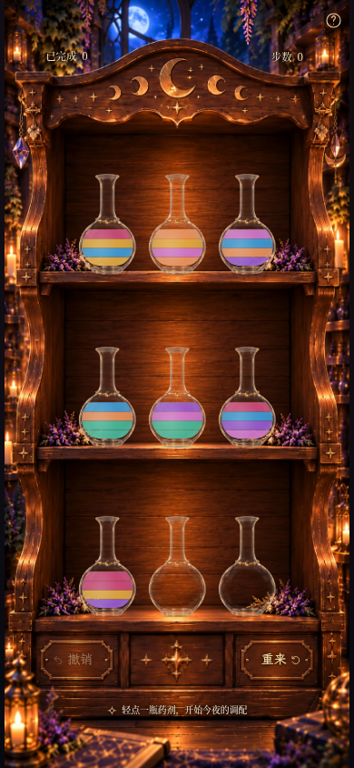
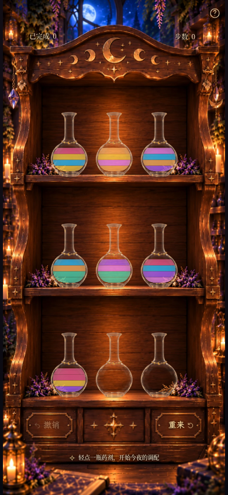
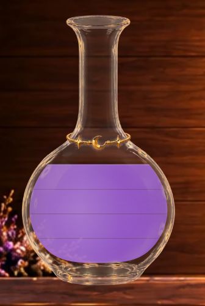
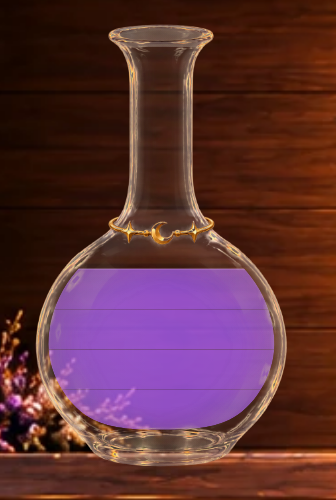
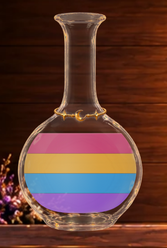
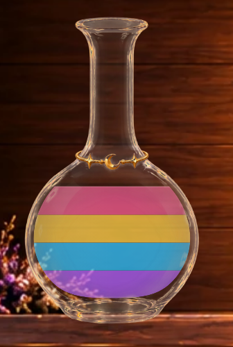

# Milestone 3I · 高饱和透明药液与更细暗缝

默认 / `?liquid=vivid-translucent` 是本轮候选。保留原3H A、B、clean及历史模式，玻璃继续使用原3G ambient。
这次主要改变液体本体的透光方式和混色前色值，分隔缝进一步收细，没有叠加新的宽白色光泽。

## 真实手机全景：同棋盘、同视口、同时间

生产构建、可玩的moon-2初始局面，390×844 / DPR1，相同2200ms捕获时刻。
本次A、B完整截图分别与3H原交付图逐像素一致；新版HUD区域也完全一致。

| 3H A · 原默认 | 3H B · 宝石光泽 | 3I · vivid-translucent（新默认） |
| --- | --- | --- |
|  |  |  |

390×844原图：[A](milestone3i-game-soft-translucent-390x844.png) · [B](milestone3i-game-gem-luster-390x844.png) · [新默认](milestone3i-game-vivid-translucent-390x844.png)。

360×640同状态：[A](milestone3i-game-soft-translucent-360x640.png) · [B](milestone3i-game-gem-luster-360x640.png) · [新默认](milestone3i-game-vivid-translucent-360x640.png)。
另有[合法34步完成局面：3H B](milestone3i-completed-gem-luster-390x844.png)与[新版七色满瓶](milestone3i-completed-vivid-translucent-390x844.png)，两图均采用减少动态效果以稳定机关光效。
另有新版[320×568视口](milestone3i-game-vivid-translucent-320x568.png)与[1280×900桌面](milestone3i-game-vivid-translucent-1280x900.png)。短屏继续使用原有纵向滚动。

请同时看正常手机全景：新版能透出更多木纹和靠壁细节，蓝紫更纯，单位暗缝更轻。
整体仍保留清楚的游戏色层；这是二维透明材质近似，视觉偏好由这些同条件画面与实际倒药共同判断。

## 典型液量、同色与异色特写

这些是**实际浏览器只读组件夹具**，使用真实木柜和 `BottleArt`，仅替换index0显示。
棋盘、历史与奖励没有改写，localStorage截图前后逐字节检查一致；页面设为 `inert`，重载退出。
主游戏图和录像来自生产构建4192；夹具由Vite4191加载同一份源码，测试模块不进入正式构建。

新版每组含正常390×844完整页，三版均提供同视口DPR4局部，未合成静态药液图片。
[夹具数组](milestone3i-fixtures.json)。数组由瓶底到瓶顶；排列中的A=紫水晶、B=蜂蜜金。

| 状态 | 新版手机完整页 | 3H A局部 | 3H B局部 | 3I局部 |
| --- | --- | --- | --- | --- |
| 空瓶 | [完整页](milestone3i-fixture-empty-390x844.png) | [A](milestone3i-fixture-empty-soft-translucent-detail.png) | [B](milestone3i-fixture-empty-gem-luster-detail.png) | [新](milestone3i-fixture-empty-vivid-translucent-detail.png) |
| 一单位蓝色 | [完整页](milestone3i-fixture-blue-1-390x844.png) | [A](milestone3i-fixture-blue-1-soft-translucent-detail.png) | [B](milestone3i-fixture-blue-1-gem-luster-detail.png) | [新](milestone3i-fixture-blue-1-vivid-translucent-detail.png) |
| 一单位紫色 | [完整页](milestone3i-fixture-purple-1-390x844.png) | [A](milestone3i-fixture-purple-1-soft-translucent-detail.png) | [B](milestone3i-fixture-purple-1-gem-luster-detail.png) | [新](milestone3i-fixture-purple-1-vivid-translucent-detail.png) |
| 一单位蜂蜜金 | [完整页](milestone3i-fixture-gold-1-390x844.png) | [A](milestone3i-fixture-gold-1-soft-translucent-detail.png) | [B](milestone3i-fixture-gold-1-gem-luster-detail.png) | [新](milestone3i-fixture-gold-1-vivid-translucent-detail.png) |
| 四单位紫色 | [完整页](milestone3i-fixture-purple-4-390x844.png) | [A](milestone3i-fixture-purple-4-soft-translucent-detail.png) | [B](milestone3i-fixture-purple-4-gem-luster-detail.png) | [新](milestone3i-fixture-purple-4-vivid-translucent-detail.png) |
| 紫 / 蓝 | [完整页](milestone3i-fixture-different-2-390x844.png) | [A](milestone3i-fixture-different-2-soft-translucent-detail.png) | [B](milestone3i-fixture-different-2-gem-luster-detail.png) | [新](milestone3i-fixture-different-2-vivid-translucent-detail.png) |
| 紫 / 蓝 / 金 / 玫瑰 | [完整页](milestone3i-fixture-different-4-390x844.png) | [A](milestone3i-fixture-different-4-soft-translucent-detail.png) | [B](milestone3i-fixture-different-4-gem-luster-detail.png) | [新](milestone3i-fixture-different-4-vivid-translucent-detail.png) |
| A / A / B / B | [完整页](milestone3i-fixture-AABB-390x844.png) | [A](milestone3i-fixture-AABB-soft-translucent-detail.png) | [B](milestone3i-fixture-AABB-gem-luster-detail.png) | [新](milestone3i-fixture-AABB-vivid-translucent-detail.png) |
| A / B / A / B | [完整页](milestone3i-fixture-ABAB-390x844.png) | [A](milestone3i-fixture-ABAB-soft-translucent-detail.png) | [B](milestone3i-fixture-ABAB-gem-luster-detail.png) | [新](milestone3i-fixture-ABAB-vivid-translucent-detail.png) |

### 同色四单位：透底与细缝

| 3H B | 3I |
| --- | --- |
|  |  |

### 四种颜色：颜色纯度与连续透光

| 3H B | 3I |
| --- | --- |
|  |  |

## 主体透明度具体如何改变

3H A/B分别使用.92/.93主体Alpha，B另有峰值.15的宽浅色光泽。
新版把所有颜色先合成到同一个图层，再通过**一次共享Alpha遮罩**透光：

- 透光场中心约.78，55%径向距离处约.76，外缘控制值为.58。当前直立满瓶的理论材质Alpha约.618–.78，倾斜药液进入细颈时可到.58（不含轮廓抗锯齿）。
- 这是液体最终可见的不透明度控制；遮罩中的白色只表达Alpha，不在画面上涂白。
- 色层先合成再统一透光，避免相邻矩形的微量抗锯齿重叠叠加两次Alpha，产生额外暗线。
- 没有不透明底漆，木纹真实参与最终颜色混合；只有峰值.035的弱侧面反光，未使用B的宽浅色光泽。

当前直立满瓶约有22%–38%的背景贡献，细颈区域可以更透，反光叠加后有很小变化；3H B主体只有约7%。
新版的透明感主要来自实际透底与连续光程近似，玻璃前景仍提供主要表面反射。

共享遮罩使用固定瓶腔坐标 `(50,100)`、半径42和纵向.76比例，不随当前液量或颜色重置。
它与瓶腔一起旋转，色层和单位平面继续反向补偿瓶身旋转，保持世界坐标水平。
湿区与真实瓶腔继续裁剪所有光学层；接收/排出只是连续揭示或隐藏同一材质，没有新动画循环或逐层阴影。

## 色彩补偿

新版保留七色名称、顺序、ID与含义，另存更鲜净的**混色前**色值以抵消深色木纹影响。
旧模式配色原样保留；新色值也通过原有导出同步用于液流，无改动流线或倒药逻辑。

| 颜色 | 3H主体色 | 新候选混色前主体色 |
| --- | --- | --- |
| 玫瑰红 | `#ce4778` | `#f35d93` |
| 紫水晶 | `#9858d2` | `#af62ff` |
| 薄荷绿 | `#43b99b` | `#51dcb6` |
| 天空蓝 | `#399bd9` | `#30c3ff` |
| 蜂蜜金 | `#e3a83d` | `#ffd04a` |
| 珊瑚橙 | `#eb915c` | `#ffb361` |
| 兰花粉 | `#d174cd` | `#f18af8` |

实际屏幕颜色仍由木纹、Alpha与玻璃合成决定。没有发光滤镜、乳白罩层或粒子。
同一局部采样点的蓝/紫/金HSV饱和度分别由约.657/.518/.673变为.749/.595/.723；
这只辅助确认透底没有让该处趋灰，整体美观仍以完整页面和录像验收。

## 分隔缝继续收细

| 参数 | 3H A/B | 3I |
| --- | --- | --- |
| 灰褐色 | `#544d47` | 同色保留 |
| 宽度 | .65 SVG单位 | **.38 SVG单位** |
| 峰值透明度 | .28 | **.20** |
| 渐隐剖面 | 0 → .05 → .28 → .05 → 0 | 0 → .035 → .20 → .035 → 0 |

线宽减少约42%，峰值再降约29%；390×844下宽度约.33 CSS px。
同色/异色采用同一轻柔暗缝，仍与原等高单位边界精确重合，没有挖出厚透明空带。
一单位/空瓶无内部线，二/三/四单位分别一/二/三道。细缝随倾斜液层移动，薄层沿用渐隐逻辑。
最顶方只保留一条.45 SVG单位、.38透明度的自由液面提示。

## 实际浏览器倒药

[MP4](milestone3i-pour.mp4) · [GIF](milestone3i-pour.gif)

390×844真实浏览器录制，277个screencast帧，采样跨度7.953秒；MP4为8.067秒，GIF为8.10秒（含结尾停留）。

正常浏览器时钟下进行四次合法触摸倒药：0→7（两单位金）、6→0（兰花粉）、0→8（两单位兰花粉）、7→0（两单位金）。
验证最后为真实4步、index0三单位金。包含选中、跨层移动、倾斜、水平液面、接收增加与返回；没有静态图拼接冒充动画。

[来源完整页](milestone3i-pour-0.png) · [接收完整页](milestone3i-pour-1.png) ·
[来源局部](milestone3i-source-detail.png) · [接收局部](milestone3i-receiver-detail.png) ·
[选中](milestone3i-selected.png) → [120ms](milestone3i-flight-120ms.png) →
[320ms](milestone3i-flight-320ms.png) → [540ms](milestone3i-flight-540ms.png) →
[790ms](milestone3i-flight-790ms.png) → [回位1040ms](milestone3i-flight-1040ms.png)。
单张关键帧由固定视口和浏览器时钟定位，视频按真实时钟录制。

## 范围、验证与限制

新增 `VividLiquid.tsx`，在 `Bottle.tsx` 接入，`liquidAppearance.ts` 增加颜色/模式并将新方案纳入原等高几何族。
`bottleGeometry.ts`、`PourAnimation.tsx`、玻璃及环境光代码/素材、木柜/九瓶尺寸位置、HUD/帮助/按钮/结算/字体、
全部 `src/game/` 均未改。**640ms提交 /920ms总时序保留**。

默认 / `?liquid=vivid-translucent` 为新候选；A/B/clean/legacy/polished/unified均可按原参数回退。
模式不写存档，没有玩家UI开关，与 `?lighting=`、`?glass=`、`?bottles=` 独立兼容。

**88项单元测试、120项Playwright浏览器测试全部通过（约3.1分钟）；生产构建与 `git diff --check` 通过。**
覆盖所有模式/存档/几何/颜色身份、新版透光与细缝、来源/接收与水平液面、撤销/刷新/减少动态效果和静置稳定性；
原玩法、结算奖励、HUD/按钮/布局及动画中断回归继续通过。

限制：这是二维连续透光近似，不模拟真实三维折射或流体惯性。木纹会轻微进入色层，薄处与不同架位的最终色调会有变化；
原始玻璃边缘反光仍可能局部提亮液体。极细同色提示在不同DPR屏幕上可见度不同。实体Safari/iOS和低端GPU尚未验证。
完成本轮后停止，等待视觉验收；无新UI、瓶型、特殊药剂或玩法。
