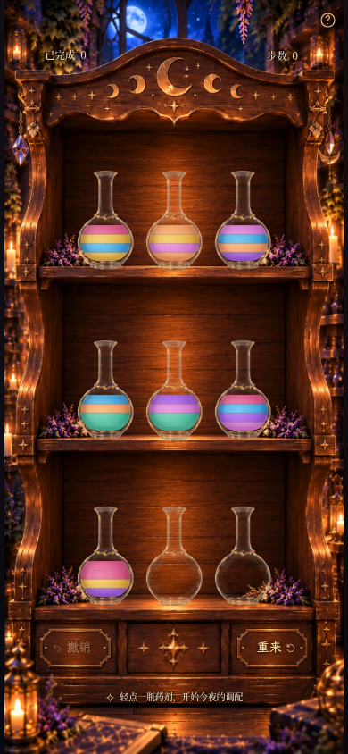
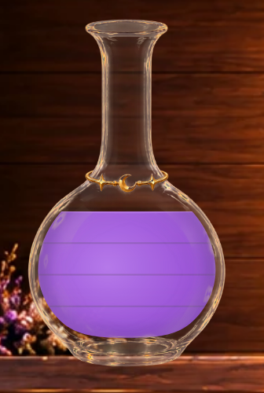
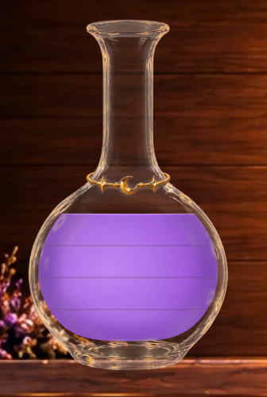
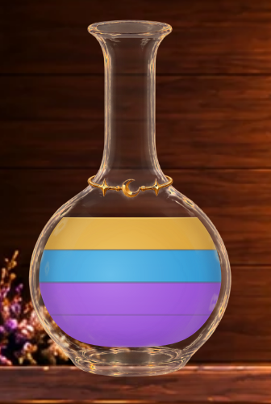
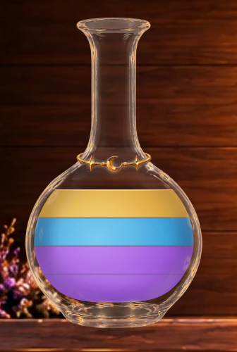

# Milestone 3J · 药液材质 A/B 与单位分界

本轮是两个可回退的二维材质候选，等待视觉验收。默认 / `?liquid=material-a` 为 A，
`?liquid=material-b` 为 B；`?liquid=luminous-liquid` 精确保留上一版，其他历史参数也保留。
所有参数仅在页面级选择，不写存档，没有新增玩家设置。

## 实际手机页面

相同 moon-2 初始棋盘、390×844 视口 / DPR1、捕获时刻2200ms，真实生产构建。
上版完整页与此前已提交的 luminous 图逐像素相同；A/B 的HUD区域与上版相同，A/B空瓶局部也逐像素相同。

| 上版 luminous-liquid | A：克制透亮 | B：更明显的宝石光泽 |
| --- | --- | --- |
|  |  |  |

360×640：[A](milestone3j-game-material-a-360x640.png) · [B](milestone3j-game-material-b-360x640.png) ·
[上版](milestone3j-game-luminous-liquid-360x640.png)。保持原有纵向滚动策略和完整木柜比例。

合法34步完成局面，查看全部七色单色满瓶：
[A](milestone3j-completed-material-a-390x844.png) · [B](milestone3j-completed-material-b-390x844.png)。
两张完成局面启用减少动态效果，仅为稳定中央机关的截图状态。

## 单瓶同条件对照

局部为390×844页面在DPR4下的实际浏览器裁剪；完整页为DPR1。
使用现有开发只读夹具，将真实 `BottleArt` 显示在实际木柜index0，页面 `inert`，存档字符串前后相同。
重载退出，不改实际谜题，不把任意颜色数组写入存档。主页面/动画用生产4192，夹具由Vite4191加载同一组件源码。
[数组记录](milestone3j-fixtures.json) 按瓶底→瓶顶排列；AABC中A=紫、B=蓝、C=金，AABB为紫/紫/金/金。

| 状态 | A局部 | B局部 | A手机完整页 | B手机完整页 |
| --- | --- | --- | --- | --- |
| 空瓶 | [A](milestone3j-fixture-empty-material-a-detail.png) | [B](milestone3j-fixture-empty-material-b-detail.png) | [A](milestone3j-fixture-empty-material-a-390x844.png) | [B](milestone3j-fixture-empty-material-b-390x844.png) |
| 1单位紫色 | [A](milestone3j-fixture-purple-1-material-a-detail.png) | [B](milestone3j-fixture-purple-1-material-b-detail.png) | [A](milestone3j-fixture-purple-1-material-a-390x844.png) | [B](milestone3j-fixture-purple-1-material-b-390x844.png) |
| 1单位蓝色 | [A](milestone3j-fixture-blue-1-material-a-detail.png) | [B](milestone3j-fixture-blue-1-material-b-detail.png) | [A](milestone3j-fixture-blue-1-material-a-390x844.png) | [B](milestone3j-fixture-blue-1-material-b-390x844.png) |
| 1单位蜂蜜金 | [A](milestone3j-fixture-gold-1-material-a-detail.png) | [B](milestone3j-fixture-gold-1-material-b-detail.png) | [A](milestone3j-fixture-gold-1-material-a-390x844.png) | [B](milestone3j-fixture-gold-1-material-b-390x844.png) |
| 同色2单位 | [A](milestone3j-fixture-mono-2-material-a-detail.png) | [B](milestone3j-fixture-mono-2-material-b-detail.png) | [A](milestone3j-fixture-mono-2-material-a-390x844.png) | [B](milestone3j-fixture-mono-2-material-b-390x844.png) |
| 同色3单位 | [A](milestone3j-fixture-mono-3-material-a-detail.png) | [B](milestone3j-fixture-mono-3-material-b-detail.png) | [A](milestone3j-fixture-mono-3-material-a-390x844.png) | [B](milestone3j-fixture-mono-3-material-b-390x844.png) |
| 同色4单位 | [A](milestone3j-fixture-mono-4-material-a-detail.png) | [B](milestone3j-fixture-mono-4-material-b-detail.png) | [A](milestone3j-fixture-mono-4-material-a-390x844.png) | [B](milestone3j-fixture-mono-4-material-b-390x844.png) |
| 四层异色 | [A](milestone3j-fixture-different-4-material-a-detail.png) | [B](milestone3j-fixture-different-4-material-b-detail.png) | [A](milestone3j-fixture-different-4-material-a-390x844.png) | [B](milestone3j-fixture-different-4-material-b-390x844.png) |
| AABC | [A](milestone3j-fixture-AABC-material-a-detail.png) | [B](milestone3j-fixture-AABC-material-b-detail.png) | [A](milestone3j-fixture-AABC-material-a-390x844.png) | [B](milestone3j-fixture-AABC-material-b-390x844.png) |
| AABB | [A](milestone3j-fixture-AABB-material-a-detail.png) | [B](milestone3j-fixture-AABB-material-b-detail.png) | [A](milestone3j-fixture-AABB-material-a-390x844.png) | [B](milestone3j-fixture-AABB-material-b-390x844.png) |

| 同色满瓶 A | 同色满瓶 B |
| --- | --- |
|  |  |

| AABC A | AABC B |
| --- | --- |
|  |  |

## 实现与参数

两版共用上一版七色及其亮调/深调，颜色身份、规则和液流颜色不变。液体总体覆盖度为 **.99**，
约1%的环境混合避免生硬抠图感，主体不依赖木纹表现材质。底色连续铺满实际湿区，再按精确单位平面覆色，
包括亮调和深调。内部抗锯齿混合相邻液色，没有透明挖空；覆盖度只统一施加一次。

所有光照均在固定瓶腔坐标中计算，填充量只揭示/隐藏同一个光照场；各单位不重启私有渐变。
高光和深部实际绘制的仍是该液色的亮/深调，遮罩白色仅编码权重，不是白色乳化光层。

| 项目 | A | B |
| --- | --- | --- |
| 宽径向体积亮区 | 权重 .70→.36→.035→0 | .94→.62→.08→0，更明确的中上部亮区 |
| 瓶壁内侧深调 | 沿实际瓶腔弧线，8单位宽遮罩、2单位柔化 | 12单位宽、2.4单位柔化，轮廓体积更明显 |
| 底部纵向深调 | 最大 .10 | 最大 .18 |
| 下部柔和反射亮区 | 无 | 一条宽而软的同色亮区，最大 .32 |

径向亮区共用中心(43,98)、半径36和纵向尺度.88；B的下部亮区中心(54,115)、半径29、纵向尺度.28。
瓶壁深调随真实瓶腔轮廓弯曲，不是矩形框。没有硬切面、白色高光块、发光滤镜、闪粉或新增动画循环。
A较均匀克制；B在完整手机页面中更亮、更有边缘浓淡，代价是插画式体积感更明显，需用户选择。

### 单位分界

**每个内部单位平面都存在提示**，按相邻颜色选择强度；同色4单位有3条弱线，AABB有2条弱线+1条异色线，
AABC有1条弱线+2条异色线。界面位置沿用原模型，静置四格严格等高。

| 类型 | 灰色 | 原始线宽 | 线本身透明度 | 柔化 |
| --- | --- | --- | --- | --- |
| 同色单位 | `#55515a` | .6 SVG单位（390×844约.52 CSS px） | .26 | 高斯标准差 .2 SVG单位 |
| 异色单位 | `#55515a` | .7 SVG单位（约.61 CSS px） | .38 | 同上 |

窄渐变曾在DPR1的特定亚像素对齐下完全漏采样，所以改为实体灰色细线加很小的局部柔化，
保持积分覆盖而不依赖渐变峰值恰好落在像素中心。模糊只作用在每条界面的4 SVG单位高窄区，
不会模糊主体或改变单位平面。线下始终有连续液色，不能透出背景；不使用纯黑线或空缝。

只有最上方自由液面有浅弧提示：端点位于水平面与旋转瓶腔的实际交点，中心最大下弯.35 SVG单位。
这只是细高光的曲率，实际填充仍由原来的水平平面裁剪；内部单位线保持水平，没有每层独立液面。

## 真实倒药

| 模式 | MP4 | GIF | 来源倾斜430ms | 接收430ms |
| --- | --- | --- | --- | --- |
| A | [视频](milestone3j-material-a-pour.mp4) | [动画](milestone3j-material-a-pour.gif) | [完整页](milestone3j-material-a-source-430ms.png) / [局部](milestone3j-material-a-source-detail.png) | [完整页](milestone3j-material-a-receiver-430ms.png) / [局部](milestone3j-material-a-receiver-detail.png) |
| B | [视频](milestone3j-material-b-pour.mp4) | [动画](milestone3j-material-b-pour.gif) | [完整页](milestone3j-material-b-source-430ms.png) / [局部](milestone3j-material-b-source-detail.png) | [完整页](milestone3j-material-b-receiver-430ms.png) / [局部](milestone3j-material-b-receiver-detail.png) |

A：[移动200ms](milestone3j-material-a-flight-200ms.png) → [返回790ms](milestone3j-material-a-flight-790ms.png) → [回位1040ms](milestone3j-material-a-flight-1040ms.png)。
B：[移动200ms](milestone3j-material-b-flight-200ms.png) → [返回790ms](milestone3j-material-b-flight-790ms.png) → [回位1040ms](milestone3j-material-b-flight-1040ms.png)。

录像由真实浏览器正常时钟和触摸操作产生，四次合法倒药0→7、6→0、0→8、7→0，最终4步、index0三单位金色。
静态关键帧单独由固定视口和浏览器时钟定位；视频未做动画寻帧或静态合成。
A/B各277个真实浏览器帧、捕获跨度分别7.958/7.958秒；MP4均为390×844、30fps、8.067秒，
GIF为390×844、20fps、8.10秒（含末帧停留）。采样帧率不代表实体手机的性能基准。
所有截图和录制页面均未报告脚本错误。

## 验证、改动范围与限制

**88项单元测试、130项Playwright测试通过（3.7分钟），生产构建和 `git diff --check` 通过。**
原有规则、完整通关、存档迁移/奖励/撤销/重来/新谜题、界面、玻璃、输入锁和减少动态效果继续通过。
两版都加入原有模式切换、来源/接收/水平界面/实际瓶口/回位/撤销/刷新/减少动态效果回归。
另一个针对性场景比较旧几何与实际覆色边缘、等高单位、所有分界类型、同色更弱、固定共享光场，
并在真实浏览器像素上检查：单色满瓶的三条提示均有可见暗度，黑白底切换在主体与接口处的RGB变化≤5/255，
A/B采样亮部存在可测差异，10秒后材质无自行变化。诊断底色仅临时存在于测试页面，未用于正常截图或产品代码。

实际代码仅新增 `src/components/MaterialLiquid.tsx`，修改 `src/components/Bottle.tsx` 的渲染选择和
`src/scene/liquidAppearance.ts` 的模式配置；对应测试为 `tests/liquid-material.spec.ts`。
文档更新 `PROGRESS.md`、`PROJECT_SPEC.md`、`README.md` 与本页，验收图片/录像为本目录 `milestone3j-*`。

全部旧液体组件未改。`bottleGeometry.ts`、`PourAnimation.tsx`、玻璃/环境光/素材、九瓶大小与落点、
木柜、HUD、帮助、按钮、字体、结算与 `src/game/` 均未改。**640ms提交 /920ms总时序**、
倾斜水平液面、瓶口流线、锁定、撤销/刷新与奖励存档沿用原机制。没有新依赖或玩家设置。

这仍是二维彩色体积光近似，不能模拟三维折射、液体厚度的真实光程或流体惯性。
异色分层本身保持规整色带，以辨色和等高为先；不能宣称已经完全消除二维色带感。
实体iOS/Safari及低端GPU未测。完成后停止，等待A/B视觉验收。
